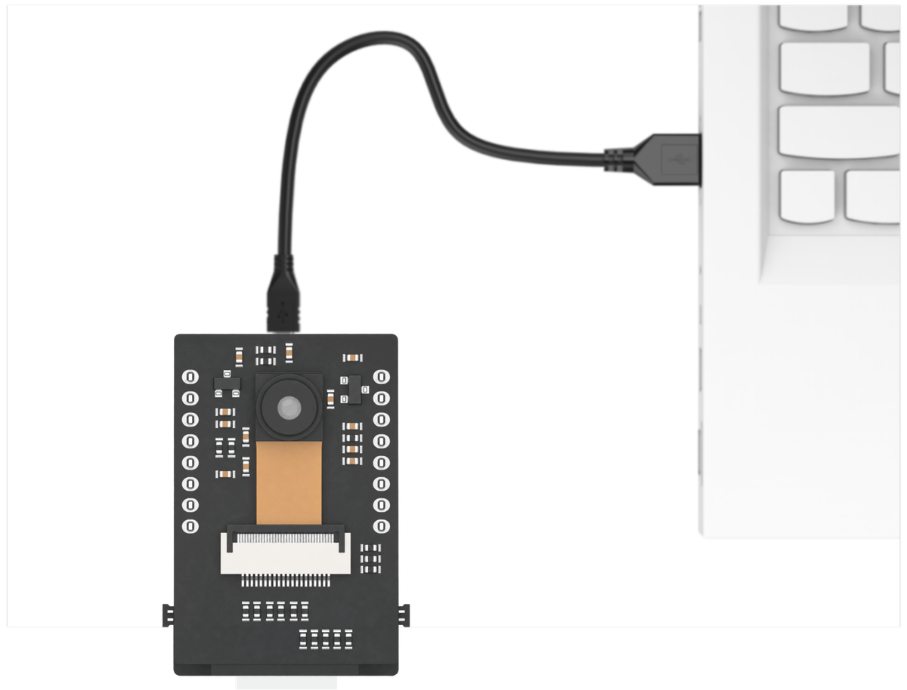
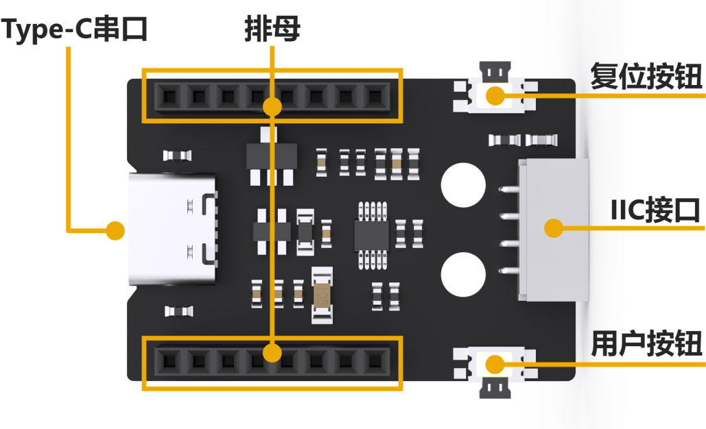
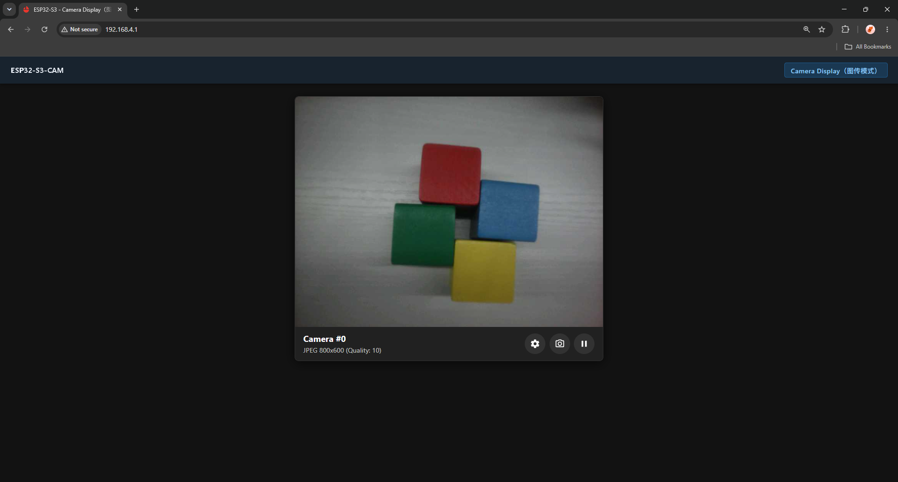
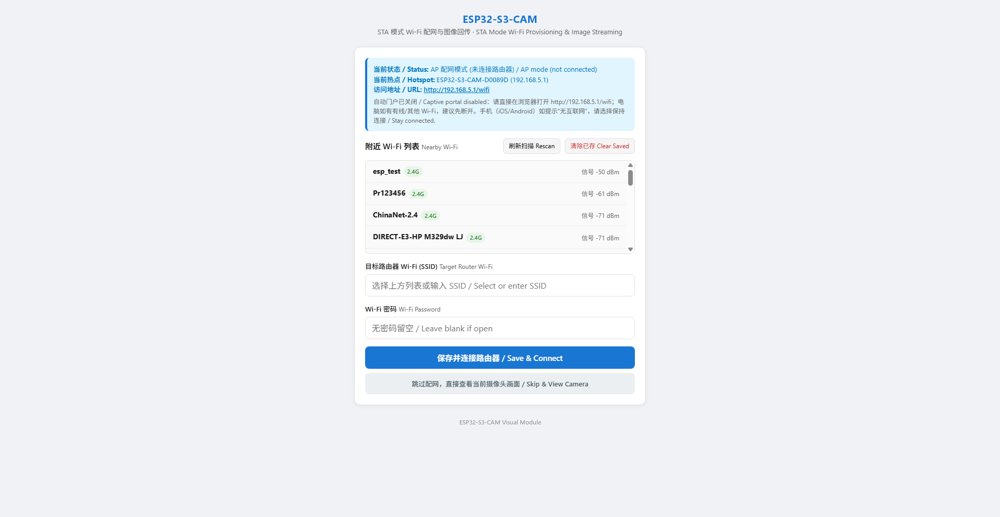

<div align="center">

# ESP32-S3-CAM



**紧凑型离线 AI 视觉识别与 2.4 GHz Wi-Fi 图传模组**

[](https://github.com/HanerQAQ/ESP32-S3-CAM/actions/workflows/ci.yml)
[](https://github.com/HanerQAQ/ESP32-S3-CAM/actions/workflows/release.yml)
[](https://docs.espressif.com/projects/esp-idf/en/v6.1/esp32s3/)
[](LICENSE)
[](examples/python_sdk/)

[English](README.md) | **简体中文**

</div>

---

## 1. 产品概述与双系列对比

**ESP32-S3-CAM** 是一款超紧凑型（`42 × 27 × 19 mm` 核心板 + 扩展底板双层堆叠结构）端侧 AI 视觉识别与无线视频图传模组。模块核心采用乐鑫 **ESP32-S3** 双核 Xtensa LX7 处理器（`240 MHz`、支持 AI 向量加速指令、集成 `8 MB` Octal PSRAM 与 `16 MB` Flash），搭配 **GC2145 200 万像素**摄像头传感器，扩展底板集成 CH340 USB 转串口芯片、防呆 I²C 扩展接口与双安装孔，即插即用。

作为与 [**ESP32-P4C5-CAM**](https://github.com/HanerQAQ/ESP32-P4C5-CAM) 一脉相承的**孪生系列**产品，两套仓库采用统一的目录规范、`0xAA 0x55` 32 字节分片 I²C 视觉协议、全平台主控 SDK（`Arduino`、`MicroPython`、`STM32 HAL`、`Raspberry Pi`、`Jetson Orin`）以及 `ColorTool` HSV 颜色阈值上位机调参工具：

| 对比维度 | **ESP32-S3-CAM** *(本仓库)* | [**ESP32-P4C5-CAM**](https://github.com/HanerQAQ/ESP32-P4C5-CAM) *(孪生旗舰版)* |
| :--- | :--- | :--- |
| **主控芯片架构** | ESP32-S3 双核 LX7 @ 240 MHz | ESP32-P4（双核 RISC-V @ 400 MHz）+ ESP32-C5（RISC-V @ 240 MHz） |
| **摄像头总线与ISP** | 并行 DVP 接口（`GC2145` 2MP） | 2-Lane MIPI-CSI（`GC2145` 2MP）+ 硬件 ISP / JPEG / PPA |
| **无线通信能力** | 2.4 GHz Wi-Fi 4（`802.11 b/g/n`）+ BLE 5.0 | 2.4 & 5 GHz 双频 Wi-Fi 6（`802.11ax`）+ BLE 5.0 |
| **I²C 从机地址与引脚** | `0x52`（`SDA=GPIO47`, `SCL=GPIO48`） | `0x54` 离线视觉 / `0x52` 无线图传（`SDA=GPIO46`, `SCL=GPIO47`） |
| **配套固件工程** | **7 套** ESP-IDF v6.1 工程（猫狗检测、人脸检测/识别、颜色与巡线、二维码、AP/STA 图传） | **12 套** ESP-IDF v6.1 工程（YOLO11n 80 类、17 关键点姿态、手势识别、AprilTag 6-DoF、人脸、猫/狗/行人、颜色巡线、二维码、AP/STA 图传） |
| **结构形态** | `42.0 × 27.0 × 19.0 mm`（核心板 + 扩展底板堆叠，`40 × 27 mm` PCB） | `42.0 × 27.0 × 19.0 mm`（核心板 + 扩展底板堆叠，`40 × 27 mm` PCB） |
| **硬件购买链接（淘宝）** | [ESP32-S3-CAM 购买链接](https://item.taobao.com/item.htm?id=791851247779) | [ESP32-P4C5-CAM 购买链接](https://item.taobao.com/item.htm?id=1089874435189) |

---

## 2. 硬件规格与接口定义

<div align="center">
  
</div>

| 硬件单元 | 规格参数说明 |
| :--- | :--- |
| **主控与存储** | ESP32-S3-N16R8 双核 LX7 @ `240 MHz`，`8 MB` Octal PSRAM，`16 MB` Flash |
| **图像传感器** | `GC2145` 200 万像素 CMOS（DVP 接口，`XCLK=20 MHz`，SCCB `SDA=GPIO4`, `SCL=GPIO5`） |
| **USB 烧录调试** | 板载 Type-C 接口，内置 CH340 USB-UART 桥接芯片（`GPIO43 TXD0`、`GPIO44 RXD0`） |
| **I²C 通信接口 (`0x52`)** | `5264-4P` 防呆端子（`5V`、`GND`、`SCL=GPIO48`、`SDA=GPIO47`，`3.3V` 电平） |
| **按键与指示灯** | `BOOT`（`GPIO0` 低电平有效；STA 固件下长按 1 秒重新配网）、`RST` 复位键、蓝色状态灯（`GPIO2`） |
| **供电要求** | **`DC 5.0 V ≥ 2.0 A`**；I²C 通信时**必须与外部主控共地 (`GND`)** |

- **硬件资料文档**：[硬件装配与调焦指南](docs/hardware_guide_zh.md) | [原理图与引脚索引](hardware/README.md) | [`SCH_S3-Cam_V1.0.pdf`](hardware/SCH_S3-Cam_V1.0.pdf)

---

## 3. 固件工程矩阵（`ESP-IDF v6.1`）

全部 7 套源码工程位于 [`firmware/`](firmware/README.md)，均基于 **ESP-IDF v6.1** 构建，可通过 `idf.py merge-bin` 导出为从 `0x0` 起始烧录的单文件固件（参见 [`prebuilt_firmware/README.md`](prebuilt_firmware/README.md) 与 **[GitHub Releases](https://github.com/HanerQAQ/ESP32-S3-CAM/releases)**）。

| 固件工程目录 | 功能说明 | 默认热点与 Web 地址 | 串口波特率 | 源码入口 |
| :--- | :--- | :--- | :---: | :--- |
| **`Image_transmission_function_STA`** | STA + SoftAP 网页配网双模图传 *(出厂默认)* | `ESP32-S3-CAM-XXXXXX`（`192.168.5.1/wifi`） | `115200` | [`firmware/Image_transmission_function_STA`](firmware/Image_transmission_function_STA) |
| **`Image_transmission_function_AP`** | 纯 SoftAP 无线实时图传（关闭 AI 获最高帧率） | `ESP32-S3-CAM-WIFI`（`192.168.4.1`） | `115200` | [`firmware/Image_transmission_function_AP`](firmware/Image_transmission_function_AP) |
| **`cat_detect`** | 离线猫狗双目标检测（`ESP-DL`） | `ESP32-S3-CAM-WIFI`（`192.168.4.1`） | `115200` | [`firmware/cat_detect`](firmware/cat_detect) |
| **`color_detect`** | 5 组色块识别与视觉巡线（阈值写入 Flash 掉电保存） | `ESP32-S3-CAM-WIFI`（`192.168.4.1`） | **`921600`** | [`firmware/color_detect`](firmware/color_detect) |
| **`human_face_detect`** | 实时人脸框检测 | `ESP32-S3-CAM-WIFI`（`192.168.4.1`） | `115200` | [`firmware/human_face_detect`](firmware/human_face_detect) |
| **`human_face_recognition`** | 人脸录入、删除与身份识别（保存至 Flash `fr` 分区） | `ESP32-S3-CAM-WIFI`（`192.168.4.1`） | `115200` | [`firmware/human_face_recognition`](firmware/human_face_recognition) |
| **`qrcode_recognition`** | 离线二维码定位与 UTF-8 文本解码 | `ESP32-S3-CAM-WIFI`（`192.168.4.1`） | `115200` | [`firmware/qrcode_recognition`](firmware/qrcode_recognition) |

<details>
<summary>界面预览：Web 实时图传与 STA 配网页面</summary>

<p align="center">
  
  
</p>

</details>

---

## 4. 快速开始

### 4.1 从源码编译（`ESP-IDF v6.1`）

激活 **ESP-IDF v6.1** 命令行环境后，支持单工程编译或一键批量编译全部 7 个工程：

```bash
# 一键批量编译全部 7 个工程并导出 0x0 合并固件至 prebuilt_firmware/
cd firmware
python build_and_verify_all.py --clean

# 或进入单个工程独立编译与烧录：
cd cat_detect
idf.py set-target esp32s3
idf.py build
idf.py -p COMx flash monitor
```

### 4.2 一键烧录合并固件（`0x0`）

从 **[GitHub Releases](https://github.com/HanerQAQ/ESP32-S3-CAM/releases)** 下载（或本地编译导出）合并固件至 `prebuilt_firmware/` 后，从 `0x0` 地址烧录：

```bash
# 使用跨平台交互烧录工具（Windows 可双击 flash.bat，Linux/macOS 可运行 ./flash.sh）
python tools/flash_firmware.py --port COMx --bin prebuilt_firmware/cat_detect.bin --erase

# 或直接使用 esptool：
python -m esptool --chip esp32s3 -p COMx -b 921600 write-flash 0x0 prebuilt_firmware/cat_detect.bin
```

### 4.3 I²C 通信连通性诊断（`0x52`）

```bash
# 无硬件模拟帧校验测试
python tools/i2c_diagnose.py --mock

# 树莓派 / Jetson Linux 总线实测探针
python tools/i2c_diagnose.py --bus 1 --addr 0x52
```

---

## 5. 全平台主控 SDK 与通信例程

| 主控平台 | 语言 / 框架 | 驱动目录 | 配套例程数 | 文档入口 |
| :--- | :--- | :--- | :---: | :--- |
| **Python SDK** *(通用核心)* | Python 3.7+（`smbus` / `ioctl`） | [`examples/python_sdk/`](examples/python_sdk/) | 全功能协议 | [`examples/python_sdk/README.md`](examples/python_sdk/README.md) |
| **Raspberry Pi** | Python（`/dev/i2c-1`） | [`examples/raspberry_pi/`](examples/raspberry_pi/) | `01` ~ `06` | [`examples/raspberry_pi/README.md`](examples/raspberry_pi/README.md) |
| **NVIDIA Jetson Orin** | Python（`/dev/i2c-7`） | [`examples/jetson_orin/`](examples/jetson_orin/) | `01` ~ `06` | [`examples/jetson_orin/README.md`](examples/jetson_orin/README.md) |
| **ESP32 Arduino / PlatformIO** | C++ 库（`ESP32_S3_CAM`） | [`examples/esp32_arduino/`](examples/esp32_arduino/) | `01` ~ `06` | [`examples/esp32_arduino/README.md`](examples/esp32_arduino/README.md) |
| **ESP32 MicroPython** | MicroPython（`machine.I2C`） | [`examples/esp32_micropython/`](examples/esp32_micropython/) | `01` ~ `06` | [`examples/esp32_micropython/README.md`](examples/esp32_micropython/README.md) |
| **STM32 HAL** | C 驱动与 CMake 接口库 | [`examples/stm32_hal/`](examples/stm32_hal/) | `01` ~ `06` | [`examples/stm32_hal/README.md`](examples/stm32_hal/README.md) |

```python
from esp32_s3_cam import ESP32_S3_CAM, RawI2C

with RawI2C(bus=1) as bus:
    cam = ESP32_S3_CAM(bus)
    result = cam.get_cat_dog_result()
    print(result)
```

---

## 6. ColorTool 颜色阈值调参上位机（`tools/color_tool/`）

<div align="center">
  
</div>

基于 **PySide6 + OpenCV** 开发的桌面端可视化调参软件，配合 `color_detect` 固件通过 Type-C 串口（`921600` 波特率）在线抓图、鼠标点击取色（支持红色色相跨区间自动处理）、实时预览二值化 Mask、导入/导出 JSON 光照预设，并一键写入模块 Flash 掉电保存。

```bash
cd tools/color_tool
pip install -r requirements.txt
python main.py
```

---

## 7. 仓库目录结构

```text
ESP32-S3-CAM/
├── .github/
│   ├── ISSUE_TEMPLATE/             # Issue 问题反馈与功能建议模板
│   ├── PULL_REQUEST_TEMPLATE.md    # Pull Request 提交检查清单
│   └── workflows/
│       ├── ci.yml                  # Python 多版本单测、SDK/Arduino 规范、死链与 PlatformIO 检查
│       └── release.yml             # Windows 版 ColorTool 自动打包与 Release 发布
├── docs/
│   ├── assets/                     # 界面截图、模组渲染图与引脚图
│   ├── hardware_guide_en.md        # 硬件装配与调焦指南（英文）
│   ├── hardware_guide_zh.md        # 硬件装配与调焦指南（中文）
│   ├── i2c_protocol_en.md          # 0x52 I2C 视觉协议规范（英文）
│   ├── i2c_protocol_zh.md          # 0x52 I2C 视觉协议规范（中文）
│   ├── uart_protocol_en.md         # ColorTool 串口调参协议（英文）
│   └── uart_protocol_zh.md         # ColorTool 串口调参协议（中文）
├── examples/
│   ├── python_sdk/                 # 可安装包 'esp32-s3-cam' Python SDK
│   ├── raspberry_pi/               # 树莓派 /dev/i2c-1 例程 (01 ~ 06)
│   ├── jetson_orin/                # NVIDIA Jetson Orin /dev/i2c-7 例程 (01 ~ 06)
│   ├── esp32_arduino/              # Arduino 1.5 规范库 ('ESP32_S3_CAM') 与 PlatformIO 配置
│   ├── esp32_micropython/          # MicroPython 驱动库与示例 (01 ~ 06)
│   └── stm32_hal/                  # STM32 HAL C 语言驱动与 CMake 构建支持
├── firmware/
│   ├── components/                 # ESP-IDF v6.1 共享组件（esp32-camera、esp-dl 等）
│   ├── Image_transmission_function_STA/
│   ├── Image_transmission_function_AP/
│   ├── cat_detect/
│   ├── color_detect/
│   ├── human_face_detect/
│   ├── human_face_recognition/
│   ├── qrcode_recognition/
│   ├── build_and_verify_all.py     # ESP-IDF v6.1 一键批量编译与导出工具
│   └── clean_for_sharing.py        # 固件构建产物清理脚本
├── hardware/                       # 原理图 PDF、芯片数据手册与结构尺寸图 SVG
├── prebuilt_firmware/              # 0x0 一体化合并固件存放目录与烧录指南
├── tests/                          # 自动化单元测试（驱动、工具、工程完整性与仓库规范）
├── tools/
│   ├── color_tool/                 # PySide6 HSV 阈值调节上位机
│   ├── git_hooks/                  # Git 提交前仓库卫生检查钩子
│   ├── clean_repo.py               # Python 缓存与构建残留清理脚本
│   ├── flash_firmware.py           # 跨平台 esptool 一键烧录工具
│   └── i2c_diagnose.py             # I2C 总线与帧协议连通性诊断脚本
├── CODE_OF_CONDUCT.md
├── CONTRIBUTING.md
├── LICENSE                         # MIT 开源许可证 (Copyright (c) 2026 HanerQAQ)
├── NOTICE
└── SECURITY.md
```

---

## 8. 文档索引

- **通信协议规范**：[I²C 视觉协议（中文）](docs/i2c_protocol_zh.md) | [I²C Vision Protocol (EN)](docs/i2c_protocol_en.md) | [串口调参协议（中文）](docs/uart_protocol_zh.md) | [UART Protocol (EN)](docs/uart_protocol_en.md)
- **硬件与结构资料**：[硬件装配与调焦指南（中文）](docs/hardware_guide_zh.md) | [Hardware Guide (EN)](docs/hardware_guide_en.md) | [原理图与引脚定义](hardware/README.md)
- **固件、工具与测试**：[固件源码指南](firmware/README.md) | [预编译固件指南](prebuilt_firmware/README.md) | [开发者工具套件](tools/README.md) | [自动化测试套件](tests/README.md)

---

## 9. 参与贡献与开源协议

- **社区贡献**：提交 Issue 或 Pull Request 前，请参阅 [`CONTRIBUTING.md`](CONTRIBUTING.md)、[`CODE_OF_CONDUCT.md`](CODE_OF_CONDUCT.md) 与 [`SECURITY.md`](SECURITY.md)。
- **开源许可**：本项目基于 **[MIT License](LICENSE)** 开源（`Copyright (c) 2026 HanerQAQ`）。所含第三方开源组件版权声明请参阅 [`NOTICE`](NOTICE)（包含 `esp32-camera`、`esp-dl`、`esp-code-scanner`、`mdns`、`PySide6`、`OpenCV` 等）。
