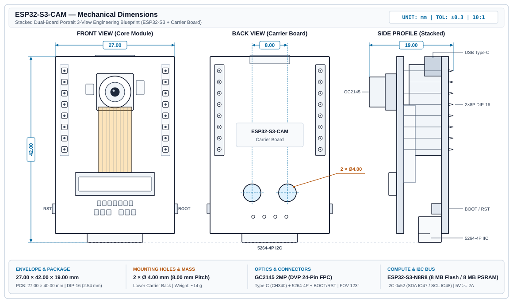
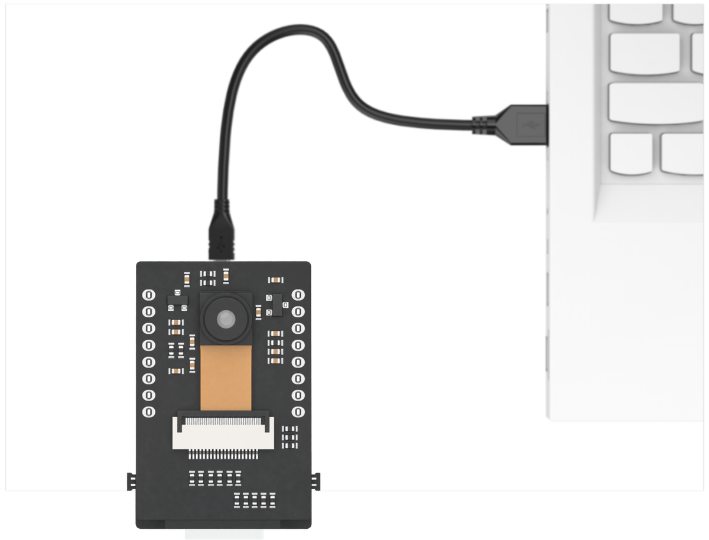

# ESP32-S3-CAM Hardware Assembly & Lens Tuning Guide

**English** | [简体中文](hardware_guide_zh.md)

This guide provides practical assembly, optical focusing, and thermal management instructions for the **ESP32-S3-CAM** vision module.

---

## 1. Camera Sensor (GC2145) Manual Focal Length Adjustment

The onboard GalaxyCore GC2145 2.0 MP camera module features an adjustable threaded M-mount lens. Proper focusing is critical for achieving optimal AI recognition accuracy and image clarity.

<div align="center">
  
</div>

### Working Distance Presets

| Application Scenario | Recommended Working Distance | Lens Adjustment Direction |
| :--- | :---: | :--- |
| **Color Tracking & Line Following** | `10 cm ~ 30 cm` | Rotate counter-clockwise (thread outward) |
| **QR Code / Barcode Scanning** | `15 cm ~ 40 cm` | Rotate counter-clockwise slightly |
| **Face Detection & Recognition** | `0.5 m ~ 1.5 m` | Rotate clockwise toward factory preset |
| **Cat & Dog Detection / General Video** | `1.0 m ~ 3.0 m` | Rotate clockwise (thread inward toward infinity) |

### Real-Time Live Focus Calibration Procedure

1. Flash the AP Video Streaming firmware:
   ```bash
   python tools/flash_firmware.py --bin prebuilt_firmware/Image_transmission_function_AP.bin
   ```
2. Power the module and connect your smartphone or laptop to Wi-Fi SSID `ESP32-S3-CAM-WIFI`.
3. Open `http://192.168.4.1:81/stream` in your browser to view the real-time MJPEG live stream.
4. Place a target (such as a printed QR code or color card) at your target working distance.
5. Gently rotate the camera lens by hand or with padded tweezers until the edges appear sharpest on the live video display.

> [!TIP]
> Once focused, a tiny dot of non-permanent silicone glue or thread-locking compound on the outer lens ring can prevent focus shift from robot motor vibrations.

---

## 2. 24-Pin FPC Camera Ribbon Cable Insertion

The camera connects to the core board via a 24-pin 0.5mm pitch FPC flip-lock connector:

1. **Open the Flip Lock**: Using a fingernail or non-conductive plastic pry tool, gently flip the brown locking bar upward by 90°. **Do not use excessive force**; the hinge is delicate.
2. **Orient the Cable**: Ensure the exposed gold contact fingers on the flexible ribbon face **downward** toward the PCB circuit traces.
3. **Insert Fully**: Slide the ribbon cable horizontally into the socket until the lateral alignment tabs sit flush against the connector edges.
4. **Lock Down**: Press the brown locking bar back down horizontally until it clicks securely into place across both sides.

---

## 3. Power Supply Recommendations

The ESP32-S3 dual-core processor (240 MHz) with Wi-Fi RF power amplifiers and high-throughput camera DMA operates with dynamic current peaks up to **1.5 A**.

<div align="center">
  
</div>

| Power Source | Compatibility | Symptoms if Underpowered |
| :--- | :---: | :--- |
| **Dedicated 5V ≥ 2A DC Supply** | :white_check_mark: Recommended | Stable operation, maximum frame rate, clear video. |
| **Raspberry Pi 5V Pin (5A Official Supply)** | :white_check_mark: Supported | Acceptable when the host power supply has ample headroom. |
| **PC USB 2.0 Port (500 mA limit)** | :x: Not Recommended | Horizontal water-ripple banding, sporadic reboot (`ESP_ERR_BROWNOUT`). |

> [!WARNING]
> If you observe horizontal rolling stripes (water ripples) or unexpected system restarts during heavy Wi-Fi streaming, the module is almost certainly suffering from supply voltage dips. Supply dedicated `5.0V >= 2.0A` power.

---

## 4. Thermal Management for Continuous AI Inference

When running neural network models (`esp-dl` MobileNet cat/dog detection, face recognition) continuously:

- **Operating Temperature**: The metal shield can typically reaches `50 °C ~ 65 °C` under sustained AI load in ambient 25 °C air. This is normal and within the SoC's rated commercial range (-20 °C to +70 °C).
- **Enclosed Enclosures**: If mounting inside a sealed 3D-printed robot chassis, attach a small **14 x 14 x 6 mm** self-adhesive aluminum heatsink to the metal RF shielding can, and leave ventilation slots above the module.

---

## 5. I2C Bus Wiring & Noise Suppression

- **Cable Length**: Keep the 4-pin `5264-4P` IIC cable under **30 cm** for clean 100 kHz transmission without signal reflection.
- **Common Ground (GND)**: Always connect the module GND directly to the master controller (Raspberry Pi, STM32, Arduino) GND.
- **Pull-Up Resistors**: The module includes onboard 4.7 kΩ pull-ups to 3.3V on GPIO47 (SDA) and GPIO48 (SCL). Do not connect 5V I2C pull-ups without level-shifting.
