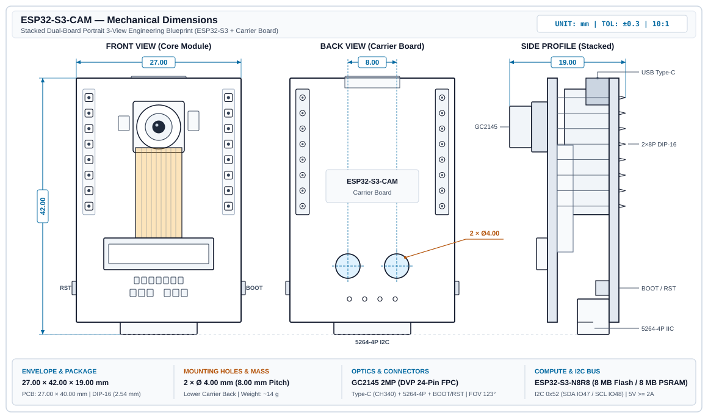
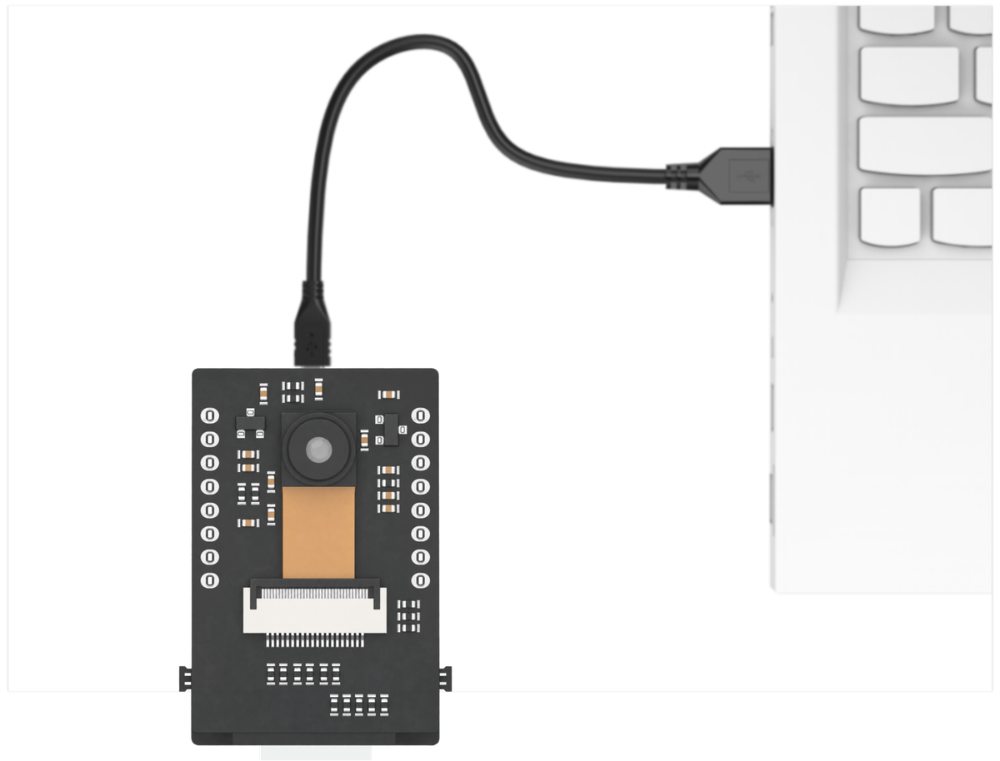

# ESP32-S3-CAM 硬件装配与镜头调焦指南

[English](hardware_guide_en.md) | **简体中文**

本指南详细介绍 **ESP32-S3-CAM** 视觉模块的硬件安装规范、GC2145 摄像头调焦技巧、供电要点与长时间运行散热建议。

---

## 1. 摄像头传感器（GC2145）手动调焦方法

板载 GalaxyCore 格科微 GC2145 200万像素摄像头带有可旋转螺纹调焦环。正确调节焦距是保证 AI 识别准确率与图像清晰度的关键前提。

<div align="center">
  
</div>

### 典型应用工作距离参考

| 应用场景 | 推荐工作物距 | 调焦方向 |
| :--- | :---: | :--- |
| **近距离颜色追踪 / 巡线** | `10 cm ~ 30 cm` | 逆时针旋出镜头（将焦点向近处拉近） |
| **二维码 / 条形码扫描** | `15 cm ~ 40 cm` | 稍逆时针旋转调准近景细节 |
| **人脸检测与人脸识别** | `0.5 m ~ 1.5 m` | 保持出厂中距或微调 |
| **猫狗宠物检测 / 远程视频监控** | `1.0 m ~ 3.0 m` | 顺时针旋紧镜头（向无穷远处对焦） |

### 实时画面辅助调焦流程

1. 烧录图传固件：
   ```bash
   python tools/flash_firmware.py --bin prebuilt_firmware/Image_transmission_function_AP.bin
   ```
2. 模块上电后，手机或电脑连接 Wi-Fi 热点 `ESP32-S3-CAM-WIFI`（无密码）。
3. 打开浏览器访问 `http://192.168.4.1:81/stream` 查看低延迟实时画面。
4. 在预定工作距离放置检测目标（如色卡、二维码或标定板）。
5. 用手或小镊子轻旋镜头边缘，观察屏幕上图像边缘的锐利程度，直至对比度达到最高即可。

> [!TIP]
> 调焦完成后，可在镜头外螺纹处点涂少量软性硅胶或可拆卸螺纹胶，防止机器人马达剧烈振动导致对焦漂移。

---

## 2. 24-Pin FPC 摄像头排线插拔规范

摄像头模组通过 24-Pin 0.5mm 翻盖式 FPC 插座连接主板：

1. **开启翻盖锁扣**：用指甲或塑料撬棒将棕色/黑色翻盖向上轻轻挑起 90°。**切勿暴力硬掰**，翻盖轴扣精密脆弱。
2. **确认排线方向**：确保柔性排线金手指朝向 **PCB 电路板接触面（金手指朝下）**。
3. **平整推入到位**：将排线水平推入插座槽底部，直到排线两侧耳扣与插座边沿对齐贴紧。
4. **压平锁死**：双手对称将翻盖向下均匀按平，听见轻微卡扣声即锁定完成。

---

## 3. 电源供电要点与防坑指南

ESP32-S3 双核 240MHz 搭配 Wi-Fi 射频功放与摄像头高速 DMA，瞬间峰值电流可达 **1.5 A** 以上。

<div align="center">
  
</div>

| 供电方式 | 适用性评价 | 供电不足常见现象 |
| :--- | :---: | :--- |
| **独立 5V ≥ 2A 直流稳压电源** | :white_check_mark: 强烈推荐 | 画面稳定纯净、帧率最高、AI 推理无掉电。 |
| **树莓派 5V 引脚（搭配原装 5A 电源）** | :white_check_mark: 可用支持 | 需确保树莓派整机供电裕量充足。 |
| **电脑 USB 2.0 接口（限流 500mA）** | :x: 不建议直接拉流 | 图像出现横向水波纹干扰、摄像头丢帧、报 `ESP_ERR_BROWNOUT` 褐断重启。 |

> [!WARNING]
> 若视频画面出现横向滚动条纹（水波纹）或在 Wi-Fi 大码率推流时频繁发生偶发重启，绝大部分原因是由于供电线压降或电流不足引起，请更换粗线径优质 Type-C 数据线并采用 `DC 5V >= 2A` 供电。

---

## 4. 长时间 AI 运行散热建议

在连续运行神经网络模型（`esp-dl` MobileNet 猫狗检测、人脸识别）时：

- **正常温升**：在 25 °C 常温下持续满载推理，金属屏蔽罩表面温度通常处于 `50 °C ~ 65 °C`，属于工业商业级芯片正常工作区间（-20 °C ~ +70 °C）。
- **封闭外壳散热**：若装配在密闭的 3D 打印机器人外壳中，建议在金属屏蔽罩表面贴附一枚 **14 x 14 x 6 mm** 导热铝制散热片，并在外壳顶部预留通风槽。

---

## 5. I2C 总线抗干扰与布线规范

- **通信线长**：`5264-4P` 4-Pin 通信线建议控制在 **30 cm 以内**，避免过长导线引入电机电磁干扰与波形电容畸变。
- **牢固共地**：确保模块 GND 与主控（树莓派、STM32、Arduino）GND 紧密相连。
- **上拉电阻**：模块内部已为 GPIO47（SDA）与 GPIO48（SCL）配备 4.7 kΩ 3.3V 上拉电阻，主机端无需额外飞线外加上拉。
