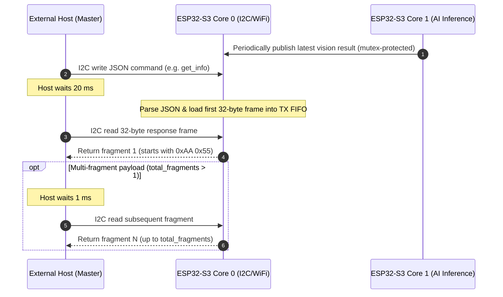
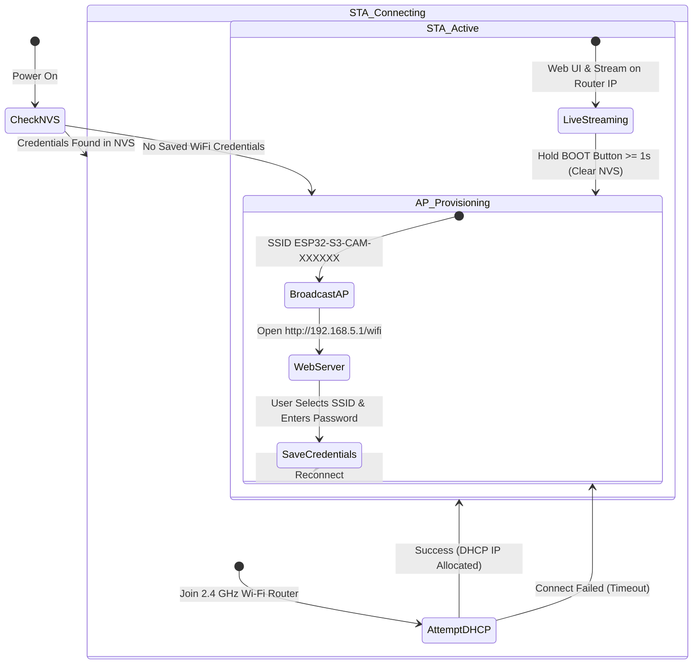

**English** | [简体中文](i2c_protocol_zh.md)

# ESP32-S3 CAM Offline Vision I2C Protocol

## 1. Protocol Architecture & Design Overview

The ESP32-S3 CAM visual module uses a **half-duplex I2C Master-Slave architecture**. Both factory and custom ESP-IDF v6.1 firmware run the module as an **I2C Slave**, allowing direct integration with **ESP32 (Arduino / MicroPython)**, **STM32 HAL**, **Raspberry Pi**, and **NVIDIA Jetson Orin** hosts.

Communication uses a **"JSON Command Downlink + Fixed 32-Byte Fragment Uplink"** hybrid protocol:
- **Host Request (Downlink)**: Plain UTF-8 JSON text string (human-readable, platform-agnostic).
- **Slave Response (Uplink)**: Compact 32-byte fixed-length binary frames with magic header, fragment IDs, payload length, and XOR checksum.

### 1.1 Physical Layer & Electrical Specifications

| Parameter | Specification |
| :--- | :--- |
| **Interface** | Standard hardware I2C / I²C bus (half-duplex) |
| **Slave Address** | **`0x52`** (7-bit address) / 8-bit write `0xA4`, 8-bit read `0xA5` |
| **Clock Speed** | `100 kHz` standard mode (compatible with `50 kHz ~ 400 kHz`) |
| **Slave Pins** | **`SDA = GPIO47`**, **`SCL = GPIO48`** (on-board pull-up resistors) |
| **Power Supply** | `DC 5V`, **`>= 2A`** peak current recommended (ensures stable Wi-Fi + camera DMA) |
| **Logic Level** | `3.3V` TTL logic (use a bidirectional level shifter for `5V` MCUs such as Arduino UNO) |

> [!IMPORTANT]
> - Verify wiring before powering on and avoid shorting bottom PCB pads with conductive objects.
> - The host MCU and ESP32-S3 CAM **must share a common `GND`**; otherwise I2C logic levels drift and checksum errors occur.

---

### 1.2 Dual-Core Firmware Architecture & Timing Sequence

ESP32-S3 integrates a dual-core Xtensa LX7 processor:
- **Core 0 (Communications & Peripherals)**: Runs the Wi-Fi stack, HTTP Web UI & MJPEG streaming server (`register_httpd`), and the I2C slave listener task (`My_IIC_Slave_Task`, priority 23).
- **Core 1 (AI Neural Inference)**: Runs real-time vision detection tasks (`task_process_handler` for cat/dog, face, color, or QR code) independently without starving Core 0.



---

### 1.3 Host Request Format (Master Request)

The host sends a standard UTF-8 JSON string via an I2C `write` transaction.

> [!NOTE]
> **Do NOT append a trailing `\0` (NULL byte)** after the JSON string. Send raw JSON bytes directly, for example:
> `{"command":"get_info","params":"cat_dog"}`

Top-level JSON fields:

| Field | Type | Description |
| :--- | :--- | :--- |
| `command` | `string` | Command type: `"get_info"`, `"vision_setting"`, `"face_register"`, `"face_delete"`, or `"module_reset"` |
| `params` | `string` / `object` / `number` | Command-specific parameter (see per-firmware sections below) |

---

### 1.4 Slave Response Format (Slave Response)

Every I2C read returns a **fixed 32-byte frame**:

| Byte Offset | Length (Bytes) | Field Name | Data Type | Description |
| :---: | :---: | :--- | :---: | :--- |
| **`0`** | `1` | `HEADER_H` | `uint8_t` | Magic header byte 0, fixed `0xAA` |
| **`1`** | `1` | `HEADER_L` | `uint8_t` | Magic header byte 1, fixed `0x55` |
| **`2 ~ 3`** | `2` | `data_len` | `uint16_t` | Valid payload bytes in this frame, little-endian (`1 ~ 23`) |
| **`4 ~ 5`** | `2` | `fragment_id` | `uint16_t` | 1-based current fragment index, little-endian |
| **`6 ~ 7`** | `2` | `total_fragments` | `uint16_t` | Total fragment count, little-endian (`1` for single-frame reply) |
| **`8 ~ 8+data_len-1`** | `data_len` | `DATA` | `bytes` | Business payload bytes for this fragment |
| **`8 + data_len`** | `1` | `CHECKSUM` | `uint8_t` | Byte-wise XOR checksum over `DATA` only |
| **`9+data_len ~ 31`** | Padding | `RESERVED` | `bytes` | Padding bytes; ignore during parsing |

- **Max Payload per Frame**: `32 - 8 (header) - 1 (checksum) = 23` bytes.
- **Fragment Reassembly**: When total payload exceeds 23 bytes (e.g., long QR text or multiple color blocks), the slave splits it across consecutive fragments (`fragment_id = 1..total_fragments`). Reassembling all `DATA` slices supports packets up to **1024 bytes**.

---

### 1.5 Endianness & XOR Checksum

1. **Little-Endian Representation**:
   - All `uint16_t` fields (`x`, `y`, `width`, `height`, `data_len`, `fragment_id`, `face_id`, etc.) are little-endian (`Data[0] | (Data[1] << 8)`).
   - All `float32` fields (line-tracking `angle` and `offset`) use IEEE 754 single-precision little-endian encoding.
2. **XOR Checksum**:
   Computed strictly across the `DATA` slice (`data_len` bytes), excluding header and padding:
   ```c
   uint8_t calc_checksum(const uint8_t *data, uint16_t len) {
       uint8_t checksum = 0;
       for (uint16_t i = 0; i < len; i++) {
           checksum ^= data[i];
       }
       return checksum;
   }
   ```

---

## 2. Host Timing & Fault-Tolerance Flow

### 2.1 Standard Polling Timing

1. **Wait after Write**: Delay **20 ms** after writing a JSON command so Core 0 parses the command and populates the I2C TX FIFO. (For `face_register` / `face_delete` in `human_face_recognition`, Flash + inference takes ~`100 ~ 200 ms`, so wait or poll accordingly.)
2. **Inter-Fragment Delay**: Delay **1 ms** between consecutive 32-byte fragment reads.
3. **Loop Interval**: Delay **20 ~ 30 ms** between queries (`30 ms` recommended for face detection/recognition, `50 ms` for QR code).

### 2.2 Single-Frame `0x55` Head-Shift Recovery

If the leading `0xAA` byte is occasionally dropped at a STOP/START transition, the read frame starts with `0x55`. Drivers should attempt automatic resynchronization:

```python
if frame[0] == 0x55:
    candidate = bytes([0xAA]) + frame[:31]
    c_data_len = candidate[2] | (candidate[3] << 8)
    if 0 < c_data_len <= 23:
        c_payload = candidate[8 : 8 + c_data_len]
        if checksum(c_payload) == candidate[8 + c_data_len]:
            frame = candidate
```

### 2.3 Retry on `0xFF` / Busy Bus

On non-RTOS Linux hosts (Raspberry Pi OS / Jetson Linux), reads may occur before the slave TX FIFO is ready (yielding `0xFF`). Drivers retry up to **3 times with a 5 ms backoff**:

```python
def receive_frame(self, retry=3):
    for attempt in range(retry + 1):
        frame = self.i2c.readfrom(self.addr, 32)
        if frame[0] != 0xAA or frame[1] != 0x55:
            if attempt < retry:
                time.sleep(0.005)
                continue
            raise ESP32_S3_CAM_Error("invalid_frame_header")
        return parse_frame(frame)
```

---

## 3. Common Control Commands (All 6 Firmware Modes)

### 3.1 Horizontal Mirror (`hmirror`)
```json
{"command":"vision_setting","params":{"hmirror":1}}
```
- `hmirror`: `1` = enable horizontal mirror, `0` = normal.
- Response `DATA[0]`: `1` = success, `0` = failure.

### 3.2 Vertical Flip (`vflip`)
```json
{"command":"vision_setting","params":{"vflip":1}}
```
- `vflip`: `1` = enable vertical flip, `0` = normal.
- Response `DATA[0]`: `1` = success, `0` = failure.

### 3.3 Software Reset (`module_reset`)
```json
{"command":"module_reset"}
```
Triggers `esp_restart()` on ESP32-S3 CAM; no response frame is needed.

---

## 4. Mode 1: Cat & Dog Detection (`cat_detect`)

- **Firmware / Source**: [`../firmware/cat_detect`](../firmware/cat_detect) ([Prebuilt / Build Guide](../prebuilt_firmware/README.md))
- **Host Examples**: `examples/*/01_cat_dog_detect` (STM32: [`../examples/stm32_hal/demos/01_cat_dog_detect_app.c`](../examples/stm32_hal/demos/01_cat_dog_detect_app.c))

### Query Command
```json
{"command":"get_info","params":"cat_dog"}
```
> [!TIP]
> `{"command":"get_info","params":"cat"}` and `{"command":"get_info","params":"dog"}` are also accepted.

### Response `DATA` Payload

| Offset | Field | Type | Description |
| :---: | :--- | :---: | :--- |
| **`data[0]`** | `total_count` | `uint8_t` | Detected target count (`0` = none detected) |
| **`data[1]`** | `target_type` | `uint8_t` | Target 1 class: **`1` = Cat**, **`2` = Dog** |
| **`data[2 ~ 3]`** | `x` | `uint16_t` | Bounding box top-left X (pixels, LE) |
| **`data[4 ~ 5]`** | `y` | `uint16_t` | Bounding box top-left Y (pixels, LE) |
| **`data[6 ~ 7]`** | `width` | `uint16_t` | Bounding box width W (pixels, LE) |
| **`data[8 ~ 9]`** | `height` | `uint16_t` | Bounding box height H (pixels, LE) |
| **`data[1+9*(N-1)]`** | `...` | `...` | Target N (`9` bytes per target) |

Total packet length: `1` byte when `total_count == 0`, else `1 + 9 * N` bytes.

---

## 5. Mode 2: Color Recognition & Line Tracking (`color_detect`)

- **Firmware / Source**: [`../firmware/color_detect`](../firmware/color_detect) ([Prebuilt / Build Guide](../prebuilt_firmware/README.md))
- **Host Examples**: `examples/*/02_color_detect` (STM32: [`../examples/stm32_hal/demos/02_color_detect_app.c`](../examples/stm32_hal/demos/02_color_detect_app.c))

### 5.1 Set Mode & Target Colors (`vision_setting`)
```json
{"command":"vision_setting","params":{"mode":0,"target":[1,2,3]}}
```
- `mode` (`uint8_t`): **`0`** = Color block tracking, **`1`** = Line following.
- `target` (`list`): `1 ~ 5` color IDs for mode `0`; **exactly `1`** color ID for mode `1`.
- Response: `data[0] = 1` (OK) or `0` (fail).

### 5.2 Query Active Configuration (`color_config`)
```json
{"command":"get_info","params":"color_config"}
```
Response (`1 + N` bytes): `data[0]` = active mode (`0` or `1`), `data[1..N]` = active color IDs.

### 5.3 Query Results (`color_result`)
```json
{"command":"get_info","params":"color_result"}
```

**When `mode == 0` (Color Block Tracking)**: returns `data[0] = 0` (1 byte) if nothing detected, otherwise (`1 + 9 * N` bytes, up to 5 blocks):

| Offset | Field | Type | Description |
| :---: | :--- | :---: | :--- |
| **`data[0]`** | `count` | `uint8_t` | Detected color blocks count |
| **`data[1]`** | `color_id` | `uint8_t` | Color ID (`1 ~ 5`, see mapping table below) |
| **`data[2 ~ 3]`** | `x` | `uint16_t` | Bounding box X (LE) |
| **`data[4 ~ 5]`** | `y` | `uint16_t` | Bounding box Y (LE) |
| **`data[6 ~ 7]`** | `width` | `uint16_t` | Bounding box width W (LE) |
| **`data[8 ~ 9]`** | `height` | `uint16_t` | Bounding box height H (LE) |

**When `mode == 1` (Line Tracking)**: fixed **17-byte** payload:

| Offset | Field | Type | Description |
| :---: | :--- | :---: | :--- |
| **`data[0]`** | `line_detected` | `uint8_t` | **`0`** = none, **`1`** = line detected |
| **`data[1 ~ 2]`** | `sx` | `uint16_t` | Start point X (LE) |
| **`data[3 ~ 4]`** | `sy` | `uint16_t` | Start point Y (LE) |
| **`data[5 ~ 6]`** | `ex` | `uint16_t` | End point X (LE) |
| **`data[7 ~ 8]`** | `ey` | `uint16_t` | End point Y (LE) |
| **`data[9 ~ 12]`** | `angle` | `float32` | Angle relative to vertical axis in degrees (LE float) |
| **`data[13 ~ 16]`** | `offset` | `float32` | Normalized horizontal offset from center in `[-1.0, 1.0]` (LE float) |

### 5.4 Standard Color ID Mapping

Aligned with `firmware/color_detect` and [`tools/color_tool`](../tools/color_tool/README.md):

| `color_id` | Color Name | Chinese | Notes |
| :---: | :--- | :--- | :--- |
| **`1`** | `Red` | 红色 | Default red preset |
| **`2`** | `Blue` | 蓝色 | Default blue preset |
| **`3`** | `Green` | 绿色 | Default green preset |
| **`4`** | `Yellow` | 黄色 | Default yellow preset |
| **`5`** | `Purple` | 紫色 | Default purple preset |

> [!TIP]
> Under different ambient lighting, use [`tools/color_tool`](../tools/color_tool/README.md) over Type-C UART (`921600` baud) to grab live camera images, click to pick HSV ranges, and persist updated thresholds into S3-CAM Flash.

---

## 6. Mode 3: Human Face Detection (`human_face_detect`)

- **Firmware / Source**: [`../firmware/human_face_detect`](../firmware/human_face_detect) ([Prebuilt / Build Guide](../prebuilt_firmware/README.md))
- **Host Examples**: `examples/*/03_face_detect` (STM32: [`../examples/stm32_hal/demos/03_face_detect_app.c`](../examples/stm32_hal/demos/03_face_detect_app.c))

### Query Command
```json
{"command":"get_info","params":"human"}
```

### Response `DATA` Payload (`1 + 9 * N` bytes; `1` byte `0` if none)

| Offset | Field | Type | Description |
| :---: | :--- | :---: | :--- |
| **`data[0]`** | `total_count` | `uint8_t` | Number of detected faces (max 5) |
| **`data[1]`** | `seq` | `uint8_t` | Face index (`1 ~ N`) |
| **`data[2 ~ 3]`** | `x` | `uint16_t` | Face box top-left X (LE) |
| **`data[4 ~ 5]`** | `y` | `uint16_t` | Face box top-left Y (LE) |
| **`data[6 ~ 7]`** | `width` | `uint16_t` | Face box width W (LE) |
| **`data[8 ~ 9]`** | `height` | `uint16_t` | Face box height H (LE) |

---

## 7. Mode 4: Human Face Recognition (`human_face_recognition`)

- **Firmware / Source**: [`../firmware/human_face_recognition`](../firmware/human_face_recognition) ([Prebuilt / Build Guide](../prebuilt_firmware/README.md))
- **Host Examples**: `examples/*/04_face_recognition` (STM32: [`../examples/stm32_hal/demos/04_face_recognition_app.c`](../examples/stm32_hal/demos/04_face_recognition_app.c))

### 7.1 Query Recognition (`face_recognition`)
```json
{"command":"get_info","params":"face_recognition"}
```

Returns `data[0] = 0` when no face is found; otherwise `1 + 10 * N` bytes (`10` bytes per face):

| Offset | Field | Type | Description |
| :---: | :--- | :---: | :--- |
| **`data[0]`** | `total_count` | `uint8_t` | Number of detected faces |
| **`data[1 ~ 2]`** | `face_id` | `uint16_t` | **`0`** = Unknown / Stranger; **`>= 1`** = Enrolled face ID (LE) |
| **`data[3 ~ 4]`** | `x` | `uint16_t` | Face box X (LE) |
| **`data[5 ~ 6]`** | `y` | `uint16_t` | Face box Y (LE) |
| **`data[7 ~ 8]`** | `width` | `uint16_t` | Face box width W (LE) |
| **`data[9 ~ 10]`** | `height` | `uint16_t` | Face box height H (LE) |

### 7.2 Enroll Face (`face_register`)
```json
{"command":"face_register"}
```
Extracts the largest detected face embedding and saves it permanently to the `fr` Flash partition:
- Failure (no face detected): `data[0] = 0` (1 byte).
- Success (3 bytes): `data[0] = 1`, `data[1 ~ 2]` (`uint16_t`, LE) = newly assigned `face_id` (`1`, `2`, `3`, ...).

### 7.3 Delete Enrolled Face (`face_delete`)
```json
{"command":"face_delete","params":1}
```
`params`: specify ID (e.g. `1`) to remove one face, or **`0`** to clear all enrolled faces. Response: `data[0] = 1` (OK) / `0` (fail).

### 7.4 Query Enrolled Count (`face_count`)
```json
{"command":"get_info","params":"face_count"}
```
Response: `data[0]` = total number of enrolled faces stored in Flash.

---

## 8. Mode 5: Image Transmission (`Image_transmission_function_AP` / `_STA`)

- **Firmware / Source**: [`../firmware/Image_transmission_function_AP`](../firmware/Image_transmission_function_AP) (AP) | [`../firmware/Image_transmission_function_STA`](../firmware/Image_transmission_function_STA) (STA) ([Prebuilt / Build Guide](../prebuilt_firmware/README.md))
- **Host Examples**: `examples/*/05_image_transmission` (STM32: [`../examples/stm32_hal/demos/05_image_transmission_app.c`](../examples/stm32_hal/demos/05_image_transmission_app.c))

Dedicated to high-speed wireless video streaming with AI disabled.
- **AP Firmware (`Image_transmission_function_AP.bin`)**: SoftAP SSID `ESP32-S3-CAM-WIFI` (open, no password), Web UI `http://192.168.4.1/`, MJPEG stream `http://192.168.4.1:81/stream`, snapshot `http://192.168.4.1/capture`.
- **STA Firmware (`Image_transmission_function_STA.bin`)**: Provisioning SoftAP `ESP32-S3-CAM-XXXXXX` (open) at `http://192.168.5.1/wifi`; after joining a 2.4 GHz router, serves camera UI & `:81/stream` on the allocated STA IP.
- **I2C Support**: Supports `hmirror`, `vflip`, and `module_reset` (Section 3).



---

## 9. Mode 6: QR Code Recognition (`qrcode_recognition`)

- **Firmware / Source**: [`../firmware/qrcode_recognition`](../firmware/qrcode_recognition) ([Prebuilt / Build Guide](../prebuilt_firmware/README.md))
- **Host Examples**: `examples/*/06_qrcode` (STM32: [`../examples/stm32_hal/demos/06_qrcode_app.c`](../examples/stm32_hal/demos/06_qrcode_app.c))

### Query Command
```json
{"command":"get_info","params":"qrcode"}
```

### Variable-Length `DATA` Payload

Returns `data[0] = 0` (1 byte) when no QR code is detected. Otherwise each QR code occupies **`11 + text_len`** bytes starting at `base = 1` (`next_base = base + 11 + text_len`):

| Relative Offset | Field | Type | Description |
| :---: | :--- | :---: | :--- |
| **`data[0]`** | `total_count` | `uint8_t` | Total QR codes decoded |
| **`data[base]`** | `index` | `uint8_t` | 1-based QR code index |
| **`data[base + 1 ~ 2]`** | `x` | `uint16_t` | Bounding box X (LE) |
| **`data[base + 3 ~ 4]`** | `y` | `uint16_t` | Bounding box Y (LE) |
| **`data[base + 5 ~ 6]`** | `width` | `uint16_t` | Bounding box width W (LE) |
| **`data[base + 7 ~ 8]`** | `height` | `uint16_t` | Bounding box height H (LE) |
| **`data[base + 9 ~ 10]`** | `text_len` | `uint16_t` | Decoded byte count `text_len` (LE) |
| **`data[base + 11 ~ ...]`** | `text` | `bytes` | Raw UTF-8 payload bytes (not null-terminated) |

---

## 10. Multi-Host Platform Matrix

| Host Platform | Directory | Driver Files | Default Hardware Bus |
| :--- | :--- | :--- | :--- |
| **ESP32 Arduino** | [`../examples/esp32_arduino`](../examples/esp32_arduino) | `ESP32_S3_CAM.h`, `ESP32_S3_CAM.cpp` | `Wire` (`SDA = GPIO21`, `SCL = GPIO22`) |
| **ESP32 MicroPython** | [`../examples/esp32_micropython`](../examples/esp32_micropython) | `ESP32_S3_CAM.py` | `I2C(0)` (`SDA = GPIO21`, `SCL = GPIO22`) |
| **STM32 (HAL)** | [`../examples/stm32_hal`](../examples/stm32_hal) | `driver/ESP32_S3_CAM.{c,h}`, `driver/ESP32_S3_CAM_port.{c,h}` | `hi2c2` (`PB11 = SDA`, `PB10 = SCL`) |
| **Raspberry Pi** | [`../examples/raspberry_pi`](../examples/raspberry_pi) | `ESP32_S3_CAM.py` (`RawI2C`) | `/dev/i2c-1` (`Pin 3 SDA`, `Pin 5 SCL`) |
| **Jetson Orin** | [`../examples/jetson_orin`](../examples/jetson_orin) | `ESP32_S3_CAM.py` (`RawI2C` auto-probe) | `Pin 3 SDA`, `Pin 5 SCL` (`/dev/i2c-7, 1, 8, 0`) |
