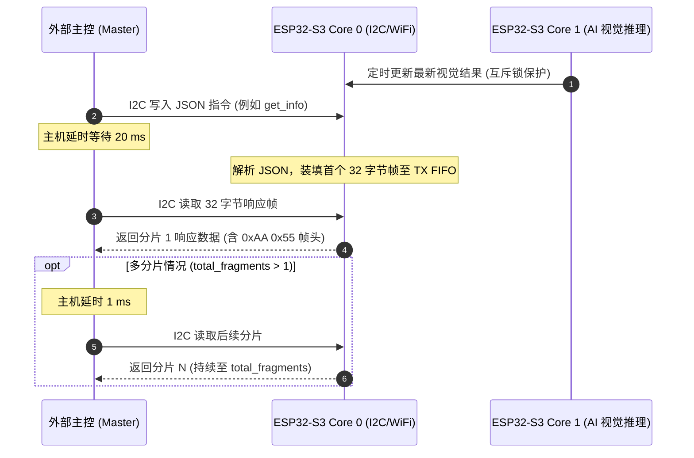
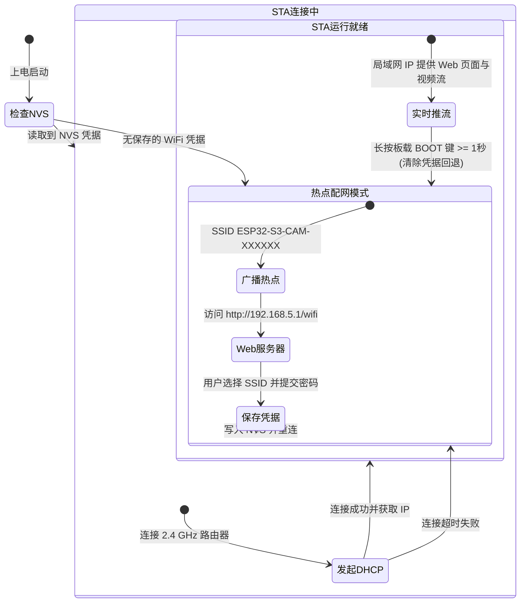

[English](i2c_protocol_en.md) | **简体中文**

# ESP32-S3 CAM 离线视觉 I2C 功能协议

## 1. 协议架构与设计规范

ESP32-S3 CAM 视觉模块采用 **I2C 主从半双工通信架构**。模块出厂及 ESP-IDF v6.1 二次开发固件均工作在 **I2C 从机模式（Slave）**，支持对接 ESP32（Arduino / MicroPython）、STM32 HAL、树莓派（Raspberry Pi）以及 NVIDIA Jetson Orin 等主流上位主控。

通信采用 **“JSON 指令下发 + 固定 32 字节分片帧返回”** 的高效混合协议：
- **主机下发**：采用纯 UTF-8 编码的精简 JSON 字符串，直观易读、跨平台兼容性强；
- **从机响应**：采用紧凑的二进制 32 字节定长帧（含帧头、分片 ID、有效载荷长度与异或校验和），兼顾实时性与低开销。

### 1.1 物理层与电气特性

| 参数项 | 规格说明 |
| :--- | :--- |
| **通信接口** | 标准硬件 I2C / I²C 总线（半双工） |
| **从机地址** | **`0x52`**（7 位地址）/ 8 位写地址 `0xA4`，8 位读地址 `0xA5` |
| **标准速率** | `100 kHz`（标准模式），兼容 `50 kHz ~ 400 kHz` |
| **从机引脚定义** | **SDA：`GPIO 47`**，**SCL：`GPIO 48`**（板载上拉电阻） |
| **推荐供电** | `DC 5V`，峰值电流建议 **≥ 2A**（保障 Wi-Fi 与摄像头高负荷工作） |
| **电平标准** | `3.3V` TTL 电平逻辑，5V 主控（如 Arduino UNO）建议加装双向电平转换模块 |

> [!IMPORTANT]
> - 通电前请确保引脚连接稳固，严禁金属导电异物接触主板底部焊点，避免造成短路。
> - 主控与 ESP32-S3 CAM 模块必须实现 **共地（GND 连接）**，否则会导致 I2C 通信电平失准或出现大量校验错误。

---

### 1.2 固件双核架构与通信时序

ESP32-S3 具备 Xtensa 双核 LX7 处理器。在固件系统调度中：
- **Core 0（通信与外设核心）**：运行 Wi-Fi 协议栈、HTTP 视频流服务器（`register_httpd`）以及 I2C 从机监听任务（`My_IIC_Slave_Task`，优先级 23）。
- **Core 1（AI 神经网络推理核心）**：独立运行 AI 检测任务（`task_process_handler`），执行人脸、猫狗、颜色或二维码识别，与 Core 0 互不抢占 CPU 周期。



---

### 1.3 主机发送格式 (Master Request)

主机发送内容为标准 UTF-8 编码的 JSON 格式文本字符串，由主机通过 I2C `write` 操作直发总线。

> [!NOTE]
> 主机下发 JSON 字符串末尾 **严禁添加额外的 `\0`（NULL 字节）**，直接发送纯 JSON 字符即可，例如：
> `{"command":"get_info","params":"cat_dog"}`

常见下发字段定义如下：

| 字段名 | 类型 | 说明 |
| :--- | :--- | :--- |
| `command` | string | 指令类型，如 `"get_info"`（查询）、`"vision_setting"`（配置）、`"face_register"`（人脸录入）、`"face_delete"`（人脸删除）、`"module_reset"`（软件复位） |
| `params` | string / object / number | 指令对应参数，详见下文各功能工程章节 |

---

### 1.4 从机响应格式 (Slave Response)

从机无论应答何种业务数据，每次 I2C 读取均返回 **固定 32 字节数据帧**。单帧结构定义如下：

| 字节偏移 | 长度 (Bytes) | 字段名称 | 数据类型 | 说明 |
| :---: | :---: | :--- | :---: | :--- |
| **0** | 1 | `HEADER_H` | `uint8_t` | 帧头高字节，固定为 **`0xAA`** |
| **1** | 1 | `HEADER_L` | `uint8_t` | 帧头低字节，固定为 **`0x55`** |
| **2 ~ 3** | 2 | `data_len` | `uint16_t` | 本帧有效载荷长度，小端序（取值范围：`1 ~ 23`） |
| **4 ~ 5** | 2 | `fragment_id` | `uint16_t` | 当前分片编号，小端序，从 `1` 开始递增 |
| **6 ~ 7** | 2 | `total_fragments` | `uint16_t` | 总分片数量，小端序（单帧应答时固定为 `1`） |
| **8 ~ 8+data_len-1** | `data_len` | `DATA` | `bytes` | 本帧有效业务数据载荷 |
| **8 + data_len** | 1 | `CHECKSUM` | `uint8_t` | 异或校验和（对本帧 `DATA` 区所有字节逐字节异或） |
| **9+data_len ~ 31** | 补齐字节 | `RESERVED` | `bytes` | 填充保留字节，解析时自动忽略 |

- **单帧载荷容量**：单个 32 字节帧最大承载有效数据为 `32 - 8 (帧头) - 1 (校验) = 23` 字节。
- **多分片拼接**：当业务总数据长度超过 23 字节（如二维码长文本、多个检测目标）时，从机会自动切分为多个分片。主机按 `fragment_id` 递增读取各帧并将 `DATA` 依次拼接，最大支持拼装 **1024 字节** 的数据包。

---

### 1.5 字节序与异或校验

1. **小端序规范（Little-Endian）**：
   - 所有 16 位整型（`uint16_t`，如坐标 `x`、`y`、`width`、`height`、`data_len`、`fragment_id`、`face_id` 等）均遵循小端序：`Data[0] | (Data[1] << 8)`。
   - 所有 32 位浮点型（`float32`，如巡线角度 `angle`、偏移量 `offset`）均采用 **IEEE 754** 单精度小端序编码。
2. **异或校验算法（XOR Checksum）**：
   校验字节仅覆盖当前帧中的 `DATA` 有效载荷区，不计入帧头、长度及填充字节：
   ```c
   uint8_t calc_checksum(const uint8_t *data, uint16_t len) {
       uint8_t checksum = 0;
       for (uint16_t i = 0; i < len; i++) {
           checksum ^= data[i];
       }
       return checksum;
   }
   ```

---

## 2. 通信交互与容错流程

### 2.1 主机查询标准时序

1. **指令发出后等待**：主机通过 I2C 写入 JSON 指令后，建议 **延时 20 ms**，确保从机解析并装填 TX FIFO。（注：`human_face_recognition` 执行 `face_register` / `face_delete` 含特征推理与 Flash 写入操作，需约 `100 ~ 200 ms`，主机需适当延长等待或轮询读取。）
2. **多分片间隔**：连续读取分片帧之间，每次读取后 **延时 1 ms**。
3. **轮询频率控制**：建议主循环每次完整查询后延时 **20 ~ 30 ms**（人脸检测/识别建议 `30 ms`，二维码建议 `50 ms`），匹配算法帧率并避免总线拥挤。

### 2.2 首字节 `0x55` 容错重组

在 STOP/START 信号切换瞬间，偶发时序抖动可能导致从机 FIFO 漏发首字节 `0xAA`，使读到的帧以 `0x55` 开头。主控驱动应支持自动重同步恢复：

```python
if frame[0] == 0x55:
    candidate = bytes([0xAA]) + frame[:31]
    c_data_len = candidate[2] | (candidate[3] << 8)
    if 0 < c_data_len <= 23:
        c_payload = candidate[8 : 8 + c_data_len]
        if checksum(c_payload) == candidate[8 + c_data_len]:
            frame = candidate
```

### 2.3 总线未就绪重试（`0xFF` 容错）

在 Raspberry Pi OS 或 Jetson Linux 等非实时系统上，主机读取若早于从机 FIFO 就绪，总线上拉将读出全 `0xFF`。驱动层内置 **3 次重试（每次延时 5 ms）**：

```python
def receive_frame(self, retry=3):
    for attempt in range(retry + 1):
        frame = self.i2c.readfrom(self.addr, 32)
        if frame[0] != 0xAA or frame[1] != 0x55:
            if attempt < retry:
                time.sleep(0.005)
                continue
            raise ESP32_S3_CAM_Error("invalid_frame_header")
        return parse_frame(frame)
```

---

## 3. 通用控制指令（六大工程通用）

### 3.1 图像水平镜像设置 (`hmirror`)
```json
{"command":"vision_setting","params":{"hmirror":1}}
```
- `hmirror`：`1` 开启水平镜像，`0` 恢复正常。
- 从机响应 `DATA[0]`：`1` 成功，`0` 失败。

### 3.2 图像垂直翻转设置 (`vflip`)
```json
{"command":"vision_setting","params":{"vflip":1}}
```
- `vflip`：`1` 开启垂直翻转，`0` 恢复正常。
- 从机响应 `DATA[0]`：`1` 成功，`0` 失败。

### 3.3 模块软件复位 (`module_reset`)
```json
{"command":"module_reset"}
```
从机收到后执行 `esp_restart()` 软件重启，主机无需等待应答帧。

---

## 4. 工程 1：猫狗检测功能协议 (`cat_detect`)

- **对应固件与源码**：[`../firmware/cat_detect`](../firmware/cat_detect)（[预编译与构建说明](../prebuilt_firmware/README.md)）
- **支持主控例程**：`examples/*/01_cat_dog_detect`（STM32 示例见 [`../examples/stm32_hal/demos/01_cat_dog_detect_app.c`](../examples/stm32_hal/demos/01_cat_dog_detect_app.c)）

### 4.1 查询指令
```json
{"command":"get_info","params":"cat_dog"}
```
> [!TIP]
> 从机同时兼容单独查询 `{"command":"get_info","params":"cat"}` 或 `{"command":"get_info","params":"dog"}`。

### 4.2 响应 `DATA` 数据包结构

| 字节偏移 | 字段名称 | 数据类型 | 说明 |
| :---: | :--- | :---: | :--- |
| **`data[0]`** | `total_count` | `uint8_t` | 当前画面检测到的目标总数（`0` 表示未检测到） |
| **`data[1]`** | `target_type` | `uint8_t` | 目标 1 类别：**`1` = 猫 (Cat)**，**`2` = 狗 (Dog)** |
| **`data[2 ~ 3]`** | `x` | `uint16_t` | 检测框左上角 X 坐标，小端序 |
| **`data[4 ~ 5]`** | `y` | `uint16_t` | 检测框左上角 Y 坐标，小端序 |
| **`data[6 ~ 7]`** | `width` | `uint16_t` | 检测框宽度 W，小端序 |
| **`data[8 ~ 9]`** | `height` | `uint16_t` | 检测框高度 H，小端序 |
| **`data[1+9*(N-1)]`** | `...` | `...` | 第 N 个目标数据，每个目标占 **9 字节** |

总长度：无目标时 `1` 字节；检测到目标时为 `1 + 9 * N` 字节。

---

## 5. 工程 2：颜色识别与巡线功能协议 (`color_detect`)

- **对应固件与源码**：[`../firmware/color_detect`](../firmware/color_detect)（[预编译与构建说明](../prebuilt_firmware/README.md)）
- **支持主控例程**：`examples/*/02_color_detect`（STM32 示例见 [`../examples/stm32_hal/demos/02_color_detect_app.c`](../examples/stm32_hal/demos/02_color_detect_app.c)）

### 5.1 工作模式与目标颜色设置 (`vision_setting`)
```json
{"command":"vision_setting","params":{"mode":0,"target":[1,2,3]}}
```
- `mode` (`uint8_t`)：**`0`** 颜色识别模式；**`1`** 视觉巡线模式。
- `target` (`list`)：颜色模式支持 `1 ~ 5` 个颜色序号；巡线模式必须且仅能填 **`1` 个** 颜色序号。
- 响应：`data[0] = 1`（成功），`0`（失败）。

### 5.2 查询当前视觉配置 (`color_config`)
```json
{"command":"get_info","params":"color_config"}
```
响应（`1 + N` 字节）：`data[0]` 为当前模式，`data[1 ~ N]` 为当前生效的目标颜色序号列表。

### 5.3 查询识别结果 (`color_result`)
```json
{"command":"get_info","params":"color_result"}
```

**1. 颜色识别模式（`mode = 0`）**：无目标返回 `data[0] = 0`（1 字节）；检测到目标返回 `1 + 9 * N` 字节（最多 5 个色块）：

| 字节偏移 | 字段名称 | 数据类型 | 说明 |
| :---: | :--- | :---: | :--- |
| **`data[0]`** | `count` | `uint8_t` | 检测到的色块总数 |
| **`data[1]`** | `color_id` | `uint8_t` | 颜色序号 `1 ~ 5`（见下表） |
| **`data[2 ~ 3]`** | `x` | `uint16_t` | 外接矩形 X 坐标，小端序 |
| **`data[4 ~ 5]`** | `y` | `uint16_t` | 外接矩形 Y 坐标，小端序 |
| **`data[6 ~ 7]`** | `width` | `uint16_t` | 外接矩形宽度 W，小端序 |
| **`data[8 ~ 9]`** | `height` | `uint16_t` | 外接矩形高度 H，小端序 |

**2. 巡线模式（`mode = 1`）**：固定返回 **17 字节**：

| 字节偏移 | 字段名称 | 数据类型 | 说明 |
| :---: | :--- | :---: | :--- |
| **`data[0]`** | `line_detected` | `uint8_t` | **`0`** 未检测到线条；**`1`** 检测到有效线条 |
| **`data[1 ~ 2]`** | `sx` | `uint16_t` | 引导线起点 X 坐标，小端序 |
| **`data[3 ~ 4]`** | `sy` | `uint16_t` | 引导线起点 Y 坐标，小端序 |
| **`data[5 ~ 6]`** | `ex` | `uint16_t` | 引导线终点 X 坐标，小端序 |
| **`data[7 ~ 8]`** | `ey` | `uint16_t` | 引导线终点 Y 坐标，小端序 |
| **`data[9 ~ 12]`** | `angle` | `float32` | 相对垂直方向倾角（单位：度），小端序浮点 |
| **`data[13 ~ 16]`** | `offset` | `float32` | 相对画面中心横向偏移量，范围 `[-1.0, 1.0]`，小端序浮点 |

### 5.4 标准颜色序号对照表

与 `firmware/color_detect` 固件预设及 [`tools/color_tool`](../tools/color_tool/README.md) 保持一致：

| 序号 (`color_id`) | 英文名称 | 中文名称 | 默认预设阈值说明 |
| :---: | :--- | :--- | :--- |
| **`1`** | `Red` | 红色 | 预设红色阈值 |
| **`2`** | `Blue` | 蓝色 | 预设蓝色阈值 |
| **`3`** | `Green` | 绿色 | 预设绿色阈值 |
| **`4`** | `Yellow` | 黄色 | 预设黄色阈值 |
| **`5`** | `Purple` | 紫色 | 预设紫色阈值 |

> [!TIP]
> 若现场光照环境与出厂预设存在差异，可使用仓库配套的 [`tools/color_tool`](../tools/color_tool/README.md) 上位机通过 Type-C 串口（`921600` 波特率）在线抓图、点选取色并将最新 HSV 阈值写入 ESP32-S3 CAM Flash 永久保存。

---

## 6. 工程 3：人脸检测功能协议 (`human_face_detect`)

- **对应固件与源码**：[`../firmware/human_face_detect`](../firmware/human_face_detect)（[预编译与构建说明](../prebuilt_firmware/README.md)）
- **支持主控例程**：`examples/*/03_face_detect`（STM32 示例见 [`../examples/stm32_hal/demos/03_face_detect_app.c`](../examples/stm32_hal/demos/03_face_detect_app.c)）

### 查询指令
```json
{"command":"get_info","params":"human"}
```

### 响应 `DATA` 数据包结构（未检测到返回 `0`，检测到返回 `1 + 9 * N` 字节）

| 字节偏移 | 字段名称 | 数据类型 | 说明 |
| :---: | :--- | :---: | :--- |
| **`data[0]`** | `total_count` | `uint8_t` | 检测到的人脸总数量（最多返回 5 个人脸） |
| **`data[1]`** | `seq` | `uint8_t` | 人脸序号（`1 ~ N`） |
| **`data[2 ~ 3]`** | `x` | `uint16_t` | 人脸框左上角 X 坐标，小端序 |
| **`data[4 ~ 5]`** | `y` | `uint16_t` | 人脸框左上角 Y 坐标，小端序 |
| **`data[6 ~ 7]`** | `width` | `uint16_t` | 人脸框宽度 W，小端序 |
| **`data[8 ~ 9]`** | `height` | `uint16_t` | 人脸框高度 H，小端序 |

---

## 7. 工程 4：人脸识别功能协议 (`human_face_recognition`)

- **对应固件与源码**：[`../firmware/human_face_recognition`](../firmware/human_face_recognition)（[预编译与构建说明](../prebuilt_firmware/README.md)）
- **支持主控例程**：`examples/*/04_face_recognition`（STM32 示例见 [`../examples/stm32_hal/demos/04_face_recognition_app.c`](../examples/stm32_hal/demos/04_face_recognition_app.c)）

### 7.1 查询识别结果 (`face_recognition`)
```json
{"command":"get_info","params":"face_recognition"}
```

未检测到返回 `data[0] = 0`；检测到返回 `1 + 10 * N` 字节（每人脸占 10 字节）：

| 字节偏移 | 字段名称 | 数据类型 | 说明 |
| :---: | :--- | :---: | :--- |
| **`data[0]`** | `total_count` | `uint8_t` | 检测到的人脸数量 |
| **`data[1 ~ 2]`** | `face_id` | `uint16_t` | **`0`** 未录入陌生人；**`>= 1`** 已录入的身份 ID（小端序） |
| **`data[3 ~ 4]`** | `x` | `uint16_t` | 人脸框 X 坐标，小端序 |
| **`data[5 ~ 6]`** | `y` | `uint16_t` | 人脸框 Y 坐标，小端序 |
| **`data[7 ~ 8]`** | `width` | `uint16_t` | 人脸框宽度 W，小端序 |
| **`data[9 ~ 10]`** | `height` | `uint16_t` | 人脸框高度 H，小端序 |

### 7.2 人脸录入注册 (`face_register`)
```json
{"command":"face_register"}
```
对画面中最大人脸提取特征并保存至 `fr` Flash 分区：
- 注册失败（未检测到人脸）：`data[0] = 0`（1 字节）；
- 注册成功（3 字节）：`data[0] = 1`，`data[1 ~ 2]`（`uint16_t`，小端序）为系统分配的新人脸 ID（`1`、`2`、`3`...）。

### 7.3 人脸删除 (`face_delete`)
```json
{"command":"face_delete","params":1}
```
`params` 填指定 ID 删除单个人脸，填 **`0`** 清空全部已录入人脸。响应：`data[0] = 1`（成功），`0`（失败）。

### 7.4 查询已录入人脸总数 (`face_count`)
```json
{"command":"get_info","params":"face_count"}
```
响应：`data[0]` 为 Flash 中保存的有效人脸总数。

---

## 8. 工程 5：图像传输功能 (`Image_transmission_function_AP` / `_STA`)

- **对应固件与源码**：[`../firmware/Image_transmission_function_AP`](../firmware/Image_transmission_function_AP)（AP）| [`../firmware/Image_transmission_function_STA`](../firmware/Image_transmission_function_STA)（STA 配网）（[预编译与构建说明](../prebuilt_firmware/README.md)）
- **支持主控例程**：`examples/*/05_image_transmission`（STM32 示例见 [`../examples/stm32_hal/demos/05_image_transmission_app.c`](../examples/stm32_hal/demos/05_image_transmission_app.c)）

专职无线图传（关闭 AI 推理以获得最高帧率），I2C 接口支持第 3 节通用控制指令（`hmirror`、`vflip`、`module_reset`）：
- **AP 模式固件**：自建开放热点 `ESP32-S3-CAM-WIFI`（无密码），Web 控制页 `http://192.168.4.1/`，MJPEG 流 `http://192.168.4.1:81/stream`，单帧抓图 `http://192.168.4.1/capture`。
- **STA 模式固件**：待配网热点 `ESP32-S3-CAM-XXXXXX`（无密码），访问 `http://192.168.5.1/wifi` 配网接入 2.4G 路由器后通过路由器分配的 STA IP 访问视频流。



---

## 9. 工程 6：二维码识别功能协议 (`qrcode_recognition`)

- **对应固件与源码**：[`../firmware/qrcode_recognition`](../firmware/qrcode_recognition)（[预编译与构建说明](../prebuilt_firmware/README.md)）
- **支持主控例程**：`examples/*/06_qrcode`（STM32 示例见 [`../examples/stm32_hal/demos/06_qrcode_app.c`](../examples/stm32_hal/demos/06_qrcode_app.c)）

### 查询指令
```json
{"command":"get_info","params":"qrcode"}
```

### 响应 `DATA` 变长结构

未检测到二维码返回 `data[0] = 0`（1 字节）。检测到二维码时每个二维码占 **`11 + text_len`** 字节（第 1 个偏移 `base = 1`，下一个 `next_base = base + 11 + text_len`）：

| 相对偏移 | 字段名称 | 数据类型 | 说明 |
| :---: | :--- | :---: | :--- |
| **`data[0]`** | `total_count` | `uint8_t` | 识别到的二维码总数 |
| **`data[base]`** | `index` | `uint8_t` | 二维码编号（`1 ~ N`） |
| **`data[base + 1 ~ 2]`** | `x` | `uint16_t` | 二维码框 X 坐标，小端序 |
| **`data[base + 3 ~ 4]`** | `y` | `uint16_t` | 二维码框 Y 坐标，小端序 |
| **`data[base + 5 ~ 6]`** | `width` | `uint16_t` | 二维码框宽度 W，小端序 |
| **`data[base + 7 ~ 8]`** | `height` | `uint16_t` | 二维码框高度 H，小端序 |
| **`data[base + 9 ~ 10]`** | `text_len` | `uint16_t` | 解码文本字节长度，小端序 |
| **`data[base + 11 ~ ...]`** | `text` | `bytes` | 原始 UTF-8 文本字节（末尾不含 `\0`） |

---

## 10. 多主控平台驱动汇总

| 主控平台 | 驱动与例程目录 | 核心驱动文件 | 默认硬件总线配置 |
| :--- | :--- | :--- | :--- |
| **ESP32 Arduino** | [`../examples/esp32_arduino`](../examples/esp32_arduino) | `ESP32_S3_CAM.h`, `ESP32_S3_CAM.cpp` | `Wire`（`SDA: GPIO21`, `SCL: GPIO22`） |
| **ESP32 MicroPython** | [`../examples/esp32_micropython`](../examples/esp32_micropython) | `ESP32_S3_CAM.py` | `I2C(0)`（`SDA: GPIO21`, `SCL: GPIO22`） |
| **STM32 (HAL)** | [`../examples/stm32_hal`](../examples/stm32_hal) | `driver/ESP32_S3_CAM.{c,h}`, `driver/ESP32_S3_CAM_port.{c,h}` | `hi2c2`（`PB11: SDA`, `PB10: SCL`） |
| **树莓派 (Raspberry Pi)** | [`../examples/raspberry_pi`](../examples/raspberry_pi) | `ESP32_S3_CAM.py` (`RawI2C`) | `/dev/i2c-1`（`Pin 3 SDA`, `Pin 5 SCL`） |
| **Jetson Orin** | [`../examples/jetson_orin`](../examples/jetson_orin) | `ESP32_S3_CAM.py` (`RawI2C` 自适配) | `Pin 3 SDA`, `Pin 5 SCL`（优先探测 `/dev/i2c-7`） |
