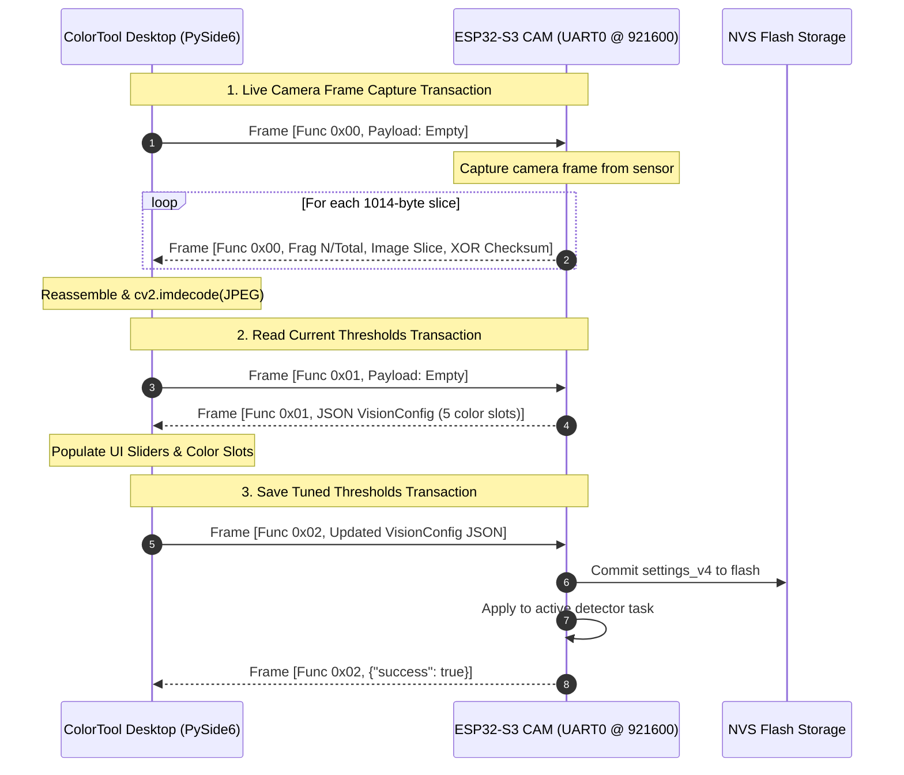

# Color Calibration UART Protocol Specification

This document defines the high-speed binary + JSON UART communication protocol between the **Color Threshold Tuning Studio (`tools/color_tool`)** and the **ESP32-S3 CAM** running the `color_detect` firmware.

[简体中文版本](uart_protocol_zh.md)

---

## 1. Physical Layer & Serial Parameters

| Parameter | Value | Notes |
| :--- | :--- | :--- |
| **Interface** | USB Type-C (On-board CH340 USB-to-UART) | Connected to ESP32-S3 `GPIO43` (TXD0) & `GPIO44` (RXD0) |
| **Baud Rate** | **`921600 bps`** | High-speed link required for real-time sensor frame acquisition |
| **Data Bits** | `8` | Standard UART byte format |
| **Parity** | `None` | No parity bit |
| **Stop Bits** | `1` | One stop bit (`8N1`) |
| **Flow Control**| `None` | RTS/CTS disabled |

---

## 2. Frame Structure & Byte Layout

Communication uses fixed-overhead, multi-fragment packet frames protected by an XOR checksum:

```text
+--------+--------+------------+---------------+-----------------+----------+------------------+----------+
| Byte 0 | Byte 1 | Byte 2..3  |   Byte 4..5   |    Byte 6..7    |  Byte 8  | Byte 9..(9+N-1)  | Byte 9+N |
+--------+--------+------------+---------------+-----------------+----------+------------------+----------+
|  0xAA  |  0x55  | DataLength |  Fragment ID  | Total Fragments | Function |     Payload      | Checksum |
+--------+--------+------------+---------------+-----------------+----------+------------------+----------+
|  Frame Header   |  uint16_le |   uint16_le   |    uint16_le    |  uint8   |     N Bytes      |  uint8   |
+--------+--------+------------+---------------+-----------------+----------+------------------+----------+
```

### Field Definitions

| Field | Size (Bytes) | Description |
| :--- | :---: | :--- |
| **Frame Header** | `2` | Fixed magic word: `0xAA 0x55`. |
| **Data Length** | `2` | Little-endian `uint16`. Total length of `Function (1 byte) + Payload (N bytes)` = `1 + N`. Max payload per frame is `1014` bytes (`MAX_FRAME_SIZE = 1024`). |
| **Fragment ID** | `2` | Little-endian `uint16`. Current fragment sequence number (1-based, `1 .. Total Fragments`). |
| **Total Fragments** | `2` | Little-endian `uint16`. Total number of fragments required to transmit the complete message. |
| **Function Code** | `1` | Command identifier (see Section 3). |
| **Payload** | `N` | Fragment data bytes (raw JPEG/image slice or UTF-8 JSON text). |
| **Checksum** | `1` | 8-bit XOR checksum covering all bytes from `Function Code` through the end of `Payload`: `XOR(data[8 .. 8+DataLength-1])`. |

---

## 3. Function Codes & Transactions

| Function Code | Name | Direction | Payload Type | Description |
| :---: | :--- | :---: | :--- | :--- |
| **`0x00`** | `FUNC_IMAGE_CAPTURE` | Host &rarr; Device | Empty / Trigger | Request single live RAW image frame from camera sensor. |
| **`0x00`** | `FUNC_IMAGE_CAPTURE` | Device &rarr; Host | Binary JPEG/RGB | Multi-fragment transmission of captured frame. |
| **`0x01`** | `FUNC_SETTINGS_READ` | Host &rarr; Device | Empty / Trigger | Request current Flash/NVS color threshold configurations. |
| **`0x01`** | `FUNC_SETTINGS_READ` | Device &rarr; Host | UTF-8 JSON | Complete VisionConfig JSON object containing 5 color slots. |
| **`0x02`** | `FUNC_SETTINGS_SAVE` | Host &rarr; Device | UTF-8 JSON | Updated VisionConfig JSON object to calibrate and save. |
| **`0x02`** | `FUNC_SETTINGS_SAVE` | Device &rarr; Host | UTF-8 JSON | Status acknowledgment (`{"success": true}`). |



---

## 4. Message Payloads

### 4.1 Live Frame Capture (`FUNC_IMAGE_CAPTURE = 0x00`)

- **Host Request**:
  - `Function`: `0x00`
  - `Payload`: Empty
- **Device Response**:
  - Multi-fragment stream where `Fragment ID` increments from `1` to `Total Fragments`.
  - Reassembling all payload slices in order yields the complete JPEG/RGB image buffer.

---

### 4.2 Read Current Settings (`FUNC_SETTINGS_READ = 0x01`)

- **Host Request**:
  - `Function`: `0x01`
  - `Payload`: Empty
- **Device Response**:
  - Returns current HSV parameters and area thresholds for all 5 color target slots:
  ```json
  {
    "command": "vision_setting",
    "params": [
      {
        "index": 1,
        "hsv_min": [158, 85, 70],
        "hsv_max": [10, 255, 255],
        "box_color": [255, 0, 0],
        "area_thr": 150
      },
      {
        "index": 2,
        "hsv_min": [90, 55, 45],
        "hsv_max": [130, 255, 255],
        "box_color": [0, 0, 255],
        "area_thr": 150
      },
      {
        "index": 3,
        "hsv_min": [38, 50, 45],
        "hsv_max": [85, 255, 255],
        "box_color": [0, 255, 0],
        "area_thr": 150
      },
      {
        "index": 4,
        "hsv_min": [18, 105, 80],
        "hsv_max": [35, 255, 255],
        "box_color": [255, 255, 0],
        "area_thr": 150
      },
      {
        "index": 5,
        "hsv_min": [132, 50, 45],
        "hsv_max": [158, 255, 255],
        "box_color": [160, 32, 240],
        "area_thr": 150
      }
    ]
  }
  ```

---

### 4.3 Save Settings to Flash (`FUNC_SETTINGS_SAVE = 0x02`)

- **Host Request**:
  - Sends updated JSON configuration matching the structure in Section 4.2.
  - Supports Hue wrap-around for red detection (`H_min > H_max`, e.g., `H_min = 158`, `H_max = 10` covers ranges `158..180` and `0..10`).
- **Device Verification & Storage**:
  1. Validates HSV bounds: `0 <= H <= 180`, `0 <= S <= 255`, `0 <= V <= 255`.
  2. Commits configuration blob to ESP32-S3 NVS flash storage (`namespace = "vision_cfg"`, `key = "settings_v4"`).
  3. Immediately applies thresholds to running computer vision detector tasks without restarting.
- **Device Acknowledgment**:
  ```json
  {"success": true}
  ```

---

## 5. Reference Checksum Algorithm (Python & C)

### Python
```python
def xor_checksum(data: bytes) -> int:
    checksum = 0
    for byte in data:
        checksum ^= byte
    return checksum
```

### C / C++
```c
uint8_t xor_checksum(const uint8_t *data, size_t len) {
    uint8_t checksum = 0;
    for (size_t i = 0; i < len; i++) {
        checksum ^= data[i];
    }
    return checksum;
}
```
