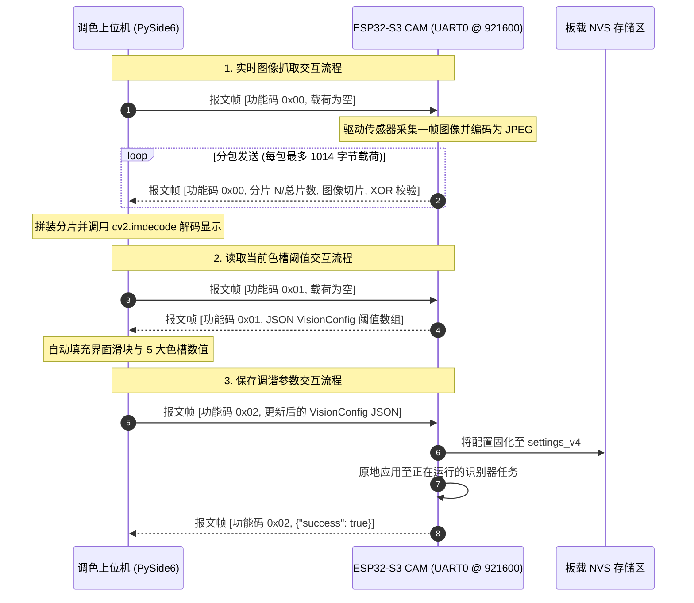

# 颜色阈值调参串口通信协议规范

本文档定义了 **上位机颜色阈值调参工具（`tools/color_tool`）** 与运行 `color_detect` 固件的 **ESP32-S3 CAM** 之间基于 Type-C 串口的高速二进制 + JSON 通信协议规范。

[English Version](uart_protocol_en.md)

---

## 1. 物理层与串口参数

| 参数项 | 配置值 | 说明 |
| :--- | :--- | :--- |
| **物理接口** | USB Type-C（板载 CH340 USB 转串口） | 直连 ESP32-S3 `GPIO43` (TXD0) 与 `GPIO44` (RXD0) |
| **波特率** | **`921600 bps`** | 高波特率专用于支持摄像头实时 RAW/JPEG 图像无延迟回传 |
| **数据位** | `8` | 标准 8 位数据格式 |
| **校验位** | `None` (无) | 无奇偶校验 |
| **停止位** | `1` | 1 位停止位 (`8N1`) |
| **流控** | `None` (无) | 关闭硬件 RTS/CTS 流控 |

---

## 2. 报文帧结构与字节布局

协议采用固定帧头与分片机制，每帧均受 8 位 XOR 校验码保护：

```text
+--------+--------+------------+---------------+-----------------+----------+------------------+----------+
| 字节 0 | 字节 1 | 字节 2..3  |   字节 4..5   |    字节 6..7    |  字节 8  | 字节 9..(9+N-1)  | 字节 9+N |
+--------+--------+------------+---------------+-----------------+----------+------------------+----------+
|  0xAA  |  0x55  | 数据区长度 |   分片编号    |    总分片数     |  功能码  |     有效载荷     |  校验和  |
+--------+--------+------------+---------------+-----------------+----------+------------------+----------+
|  固定帧头 2B    |  uint16_le |   uint16_le   |    uint16_le    |  uint8   |     N 字节       |  uint8   |
+--------+--------+------------+---------------+-----------------+----------+------------------+----------+
```

### 字段说明

| 字段名 | 长度 (字节) | 说明 |
| :--- | :---: | :--- |
| **固定帧头** | `2` | 固定魔数：`0xAA 0x55`。 |
| **数据区长度** | `2` | 小端序 `uint16`。定义 `功能码 (1B) + 有效载荷 (N 字节)` 的总长度，即 `1 + N`。单帧最大载荷为 `1014` 字节（最大单帧大小 `MAX_FRAME_SIZE = 1024`）。 |
| **分片编号** | `2` | 小端序 `uint16`。当前分片序号（从 `1` 开始，递增至 `总分片数`）。 |
| **总分片数** | `2` | 小端序 `uint16`。传输完整报文所需的总分片数量。 |
| **功能码** | `1` | 交互指令识别码（详见第 3 节）。 |
| **有效载荷** | `N` | 当前分片承载的具体数据（图像二进制切片或 UTF-8 JSON 文本）。 |
| **校验和** | `1` | 8 位异或校验（XOR），计算范围覆盖 `功能码` 到 `有效载荷末尾`：`XOR(data[8 .. 8+DataLength-1])`。 |

---

## 3. 功能码定义与交互流程

| 功能码 | 功能定义 | 发起方与流向 | 数据载荷类型 | 详细说明 |
| :---: | :--- | :---: | :--- | :--- |
| **`0x00`** | `FUNC_IMAGE_CAPTURE` | 上位机 &rarr; 下位机 | 空载荷 / 触发 | 请求下位机采集单帧实时 RAW/JPEG 图像。 |
| **`0x00`** | `FUNC_IMAGE_CAPTURE` | 下位机 &rarr; 上位机 | 二进制 JPEG/RGB | 分片回传捕获的完整摄像头图像流。 |
| **`0x01`** | `FUNC_SETTINGS_READ` | 上位机 &rarr; 下位机 | 空载荷 / 触发 | 请求下位机回传当前 Flash/NVS 保存的 5 色阈值参数。 |
| **`0x01`** | `FUNC_SETTINGS_READ` | 下位机 &rarr; 上位机 | UTF-8 JSON | 包含当前 5 色色槽的完整 JSON 对象。 |
| **`0x02`** | `FUNC_SETTINGS_SAVE` | 上位机 &rarr; 下位机 | UTF-8 JSON | 上位机调节完毕后下发保存的新颜色阈值配置。 |
| **`0x02`** | `FUNC_SETTINGS_SAVE` | 下位机 &rarr; 上位机 | UTF-8 JSON | 写入与校验状态应答（`{"success": true}`）。 |



---

## 4. 报文载荷规范

### 4.1 图像抓取报文 (`FUNC_IMAGE_CAPTURE = 0x00`)

- **上位机请求**：功能码 `0x00`，有效载荷为空。
- **下位机响应**：
  - 以多帧分片形式顺序回传，`分片编号` 从 `1` 递增至 `总分片数`。
  - 上位机按顺序拼装全部载荷数据即可获得完整的 JPEG 图像二进制缓冲，通过 OpenCV `cv2.imdecode()` 即可解码为 BGR 矩阵。

---

### 4.2 阈值读取报文 (`FUNC_SETTINGS_READ = 0x01`)

- **上位机请求**：功能码 `0x01`，有效载荷为空。
- **下位机响应**：
  - 返回包含当前 5 大色槽阈值的 JSON 数据：
  ```json
  {
    "command": "vision_setting",
    "params": [
      {
        "index": 1,
        "hsv_min": [158, 85, 70],
        "hsv_max": [10, 255, 255],
        "box_color": [255, 0, 0],
        "area_thr": 150
      },
      {
        "index": 2,
        "hsv_min": [90, 55, 45],
        "hsv_max": [130, 255, 255],
        "box_color": [0, 0, 255],
        "area_thr": 150
      },
      {
        "index": 3,
        "hsv_min": [38, 50, 45],
        "hsv_max": [85, 255, 255],
        "box_color": [0, 255, 0],
        "area_thr": 150
      },
      {
        "index": 4,
        "hsv_min": [18, 105, 80],
        "hsv_max": [35, 255, 255],
        "box_color": [255, 255, 0],
        "area_thr": 150
      },
      {
        "index": 5,
        "hsv_min": [132, 50, 45],
        "hsv_max": [158, 255, 255],
        "box_color": [160, 32, 240],
        "area_thr": 150
      }
    ]
  }
  ```

---

### 4.3 阈值持久化写入 (`FUNC_SETTINGS_SAVE = 0x02`)

- **上位机请求**：
  - 携带如 4.2 所示结构的 JSON 配置数据。
  - 支持红色通道跨边界特性（`H_min > H_max`，例如 `H_min = 158`、`H_max = 10` 时，内部自动分割为 `158..180` 和 `0..10` 两个掩膜）。
- **下位机校验与存储**：
  1. 严格校验参数合法性（HSV 范围：`0 <= H <= 180`，`0 <= S <= 255`，`0 <= V <= 255`）。
  2. 写入 ESP32-S3 NVS Flash 存储区（命名空间 `vision_cfg`，键名 `settings_v4`）。
  3. 写入后立即原地重新加载并应用至当前运行中的颜色识别检测器任务，**无需重启模块**即可即时生效。
- **下位机应答**：
  ```json
  {"success": true}
  ```

---

## 5. 参考校验算法实现

### Python
```python
def xor_checksum(data: bytes) -> int:
    checksum = 0
    for byte in data:
        checksum ^= byte
    return checksum
```

### C / C++
```c
uint8_t xor_checksum(const uint8_t *data, size_t len) {
    uint8_t checksum = 0;
    for (size_t i = 0; i < len; i++) {
        checksum ^= data[i];
    }
    return checksum;
}
```
