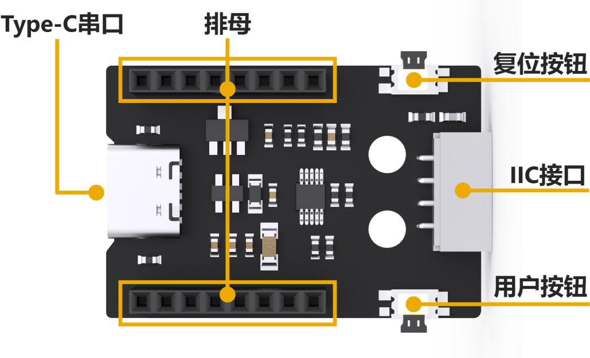
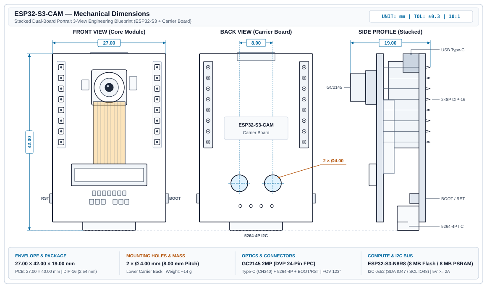

# Hardware Documents & Pinout / 硬件资料与引脚说明

This folder contains lightweight PDF technical references for the **ESP32-S3-CAM V1.0** module:

本目录包含 **ESP32-S3-CAM V1.0** 模块的电路原理图与核心芯片数据手册：

- [`SCH_S3-Cam_V1.0.pdf`](SCH_S3-Cam_V1.0.pdf) — Complete module schematic (power, USB-UART CH340, camera FPC, I2C header & ESP32-S3 pin routing) / 模块完整电路原理图
- [`ESP32-S3_Datasheet.pdf`](ESP32-S3_Datasheet.pdf) — Espressif ESP32-S3 SoC Datasheet / 乐鑫 ESP32-S3 芯片规格书
- [`GC2145_Datasheet.pdf`](GC2145_Datasheet.pdf) — GalaxyCore GC2145 2MP CMOS Image Sensor Datasheet / 格科微 GC2145 摄像头传感器规格书
- [Hardware Assembly & Lens Focus Guide (English)](../docs/hardware_guide_en.md) | [硬件装配与镜头调焦指南（中文）](../docs/hardware_guide_zh.md)

---

## Module Interface Overview / 模块接口概览

  

| Interface / Pin | ESP32-S3 GPIO | Description / 说明 |
| :--- | :---: | :--- |
| **I2C Slave SDA** | `GPIO47` | Shared on 4-pin `5264-4P` IIC connector & `2×8P` headers |
| **I2C Slave SCL** | `GPIO48` | Shared on 4-pin `5264-4P` IIC connector & `2×8P` headers |
| **USB-UART (CH340)** | `GPIO43` (TXD0), `GPIO44` (RXD0) | Firmware flashing, serial logs & ColorTool calibration |
| **Camera SCCB** | `GPIO4` (SDA), `GPIO5` (SCL) | Internal camera sensor bus |
| **Onboard Blue LED** | `GPIO2` | Active low status LED |
| **BOOT / User Button** | `GPIO0` | Download mode on reset; in STA firmware: short press = status, 1s hold = AP provisioning |
| **Power Supply** | `5V`, `GND` | Recommended `DC 5V >= 2A` |

---

## Mechanical Dimensions & Physical Specifications / 结构尺寸与物理规格

  

| Parameter / 规格参数 | Value / 数值 | Notes / 备注 |
| :--- | :--- | :--- |
| **Overall Assembled / 整机堆叠尺寸** | `42.0 mm × 27.0 mm × 19.0 mm` | Core + Carrier stacked (incl. IIC connector & lens) / 含底板、镜头与 IIC 端子 |
| **Core & Carrier PCB / 单板 PCB 尺寸** | `40.0 mm × 27.0 mm` | PCB thickness: `1.6 mm` / 双层板厚 `1.6 mm` |
| **Mounting Holes / 底板安装定位孔** | `2 × ⌀ 4.0 mm` | Vertical pitch `8.0 mm`, `10.0 mm` from right edge / 竖排双孔间距 `8.0 mm` |
| **Board-to-Board Headers / 板间排针排母** | `2 × 8P` (`2.54 mm` pitch) | Row-to-row spacing `22.86 mm` (`0.9"`) / 双排间距 `22.86 mm` |
| **I2C Connector / I2C 通讯端子** | `4-Pin 5264-4P` | Keyed 4-pin header (`5V`, `GND`, `SCL=IO48`, `SDA=IO47`) |
| **USB Interface / USB 接口** | USB Type-C Receptacle | Onboard CH340 USB-UART bridge |
| **Operating Voltage / 工作电压** | `DC 5.0 V` | Recommended supply current `≥ 2.0 A` |
| **Operating Temperature / 工作温度** | `-20 °C ~ +70 °C` | Commercial industrial grade |

> **3D CAD Models (`.stp` / `.stl`)**: To avoid bloating Git history (~69 MB total), 3D mechanical CAD files (`ESP32S3-Cam.stp` and `ESP32–Cam电路板.stl`) are omitted here and can be attached to **GitHub Releases**.
