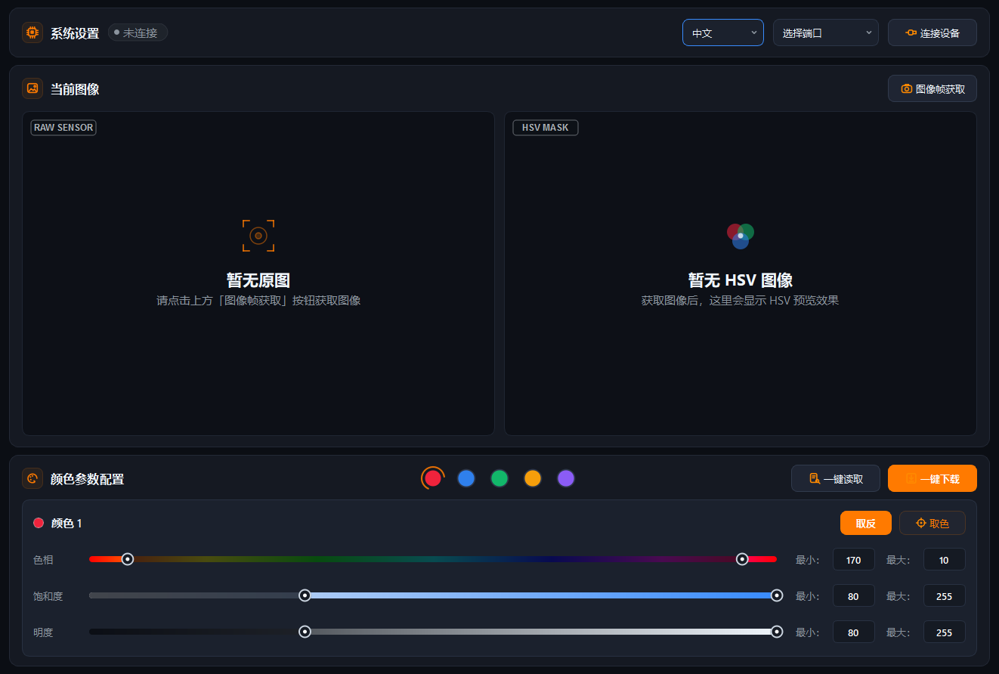

# ColorTool v1.0 — Color Threshold Tuning Studio / 颜色阈值上位机调参工具

A **PySide6 + OpenCV** desktop studio for online camera frame capture, interactive HSV color threshold calibration, real-time HSV mask preview, and permanent Flash storage on **ESP32-S3 CAM** running `color_detect` firmware.

基于 **PySide6 + OpenCV** 开发的 ESP32-S3 CAM 颜色识别阈值上位机调节工具源码。配合烧录了 `color_detect.bin` 的模块，通过 Type-C 串口在线抓图、鼠标点选取色、实时预览 HSV 掩膜效果，并一键写入模块 Flash 掉电保存。

<div align="center">
  
</div>

---

## Features / 核心特性

- **Live Frame Capture (`0xAA 0x55`)**: Grabs real-time RGB/JPEG frames directly over USB UART (`921600` baud). See [UART Protocol Specification](../../docs/uart_protocol_en.md) / [串口协议规范](../../docs/uart_protocol_zh.md).
- **Interactive Click-to-Pick**: Click on any object in the RAW sensor view to auto-populate HSV min/max ranges with hue wrap-around support (red channel `H > H_max`, e.g., `170..10`).
- **5 Standard Color Slots (`1 ~ 5`)**: `1: Red`, `2: Blue`, `3: Green`, `4: Yellow`, `5: Purple` — matching [`firmware/color_detect`](../../firmware/color_detect).
- **JSON Preset Import & Export**: Save tuned thresholds or load pre-calibrated profiles from [`presets/`](presets/) for indoor lighting or outdoor direct sunlight.
- **One-Click Read & Download**: Read current thresholds from Flash or save tuned parameters permanently over serial.
- **Bilingual UI**: Switch seamlessly between Simplified Chinese and English inside the top-right language dropdown.

---

## Quick Start / 运行方法

> **Prerequisites**: Python 3.10+ recommended. Build or download `color_detect.bin` ([`firmware/color_detect`](../../firmware/color_detect) / [`prebuilt_firmware/README.md`](../../prebuilt_firmware/README.md)) and flash it to your ESP32-S3-CAM first.

```bash
cd tools/color_tool
pip install -r requirements.txt
python main.py

# Or install in editable mode for the 'colortool' CLI command:
pip install -e .
colortool
```

On Windows, you can also double-click `run.bat` after installing dependencies.

### Dependencies (`requirements.txt`)
- `PySide6>=6.6.0`
- `opencv-python>=4.9.0`
- `numpy>=1.26.0`
- `pyserial>=3.5`

---

## Build Windows Standalone `.exe` / 打包独立可执行文件

Install PyInstaller (`pip install pyinstaller`), ensure `python` is in your `PATH`, and run:

```cmd
build_exe.bat
```

Output will be generated in `dist\ColorTool_v1.0.exe` and copied next to `main.py` (ignored by `.gitignore`).

---

## Serial Calibration Protocol Summary / 串口协议简述

Implemented in [`vision_control/protocol/serial_protocol.py`](vision_control/protocol/serial_protocol.py) (`921600` baud, 8N1):
- **Frame Format**: `0xAA 0x55` + `len` (`uint16_le`) + `fragment_id` (`uint16_le`) + `total_fragments` (`uint16_le`) + `function` (`uint8`) + `payload` + `XOR_checksum` (`uint8`)
- **Function Codes**:
  - `0` (`FUNC_IMAGE_CAPTURE`) — Request/receive camera image fragments
  - `1` (`FUNC_SETTINGS_READ`) — Read saved HSV thresholds from Flash
  - `2` (`FUNC_SETTINGS_SAVE`) — Write updated HSV thresholds permanently to Flash
